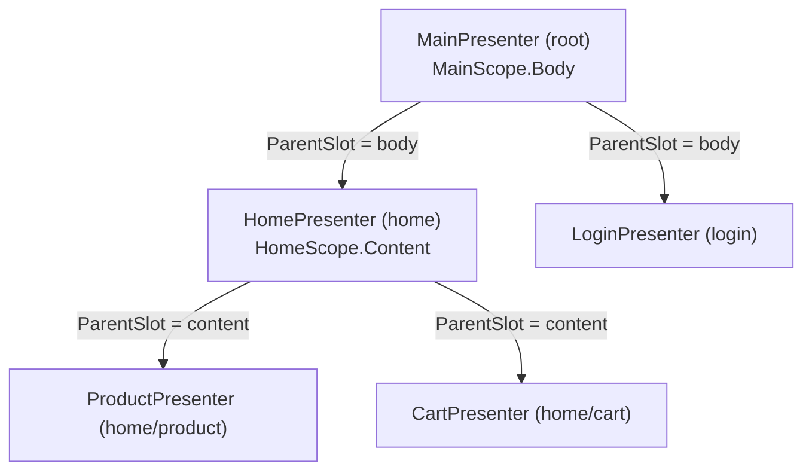

# Architecture

A Cube application is a tree of **places**. Each place is owned by a **presenter** that holds the logic and the
state of one part of the screen, and publishes what the view should draw in a **scope**. The set of presenters alive
at a moment is called a *face* of the cube; moving from one face to another is a *flip*, requested with a
**FlipIntent**. The point of this split is that everything that decides behavior (what to load, what to show, where
to go) is plain C# with no reference to a rendering technology, so it can be tested without a UI and drawn by Blazor,
Avalonia or anything else.

## Places and the place tree

A `Place` is an immutable node of the tree. It has a name, a parent, and optionally a factory that creates its
presenter. Places are usually declared once, as static fields:

```csharp
public static class Places
{
    public static readonly Place Main = Place.Root; // the application itself

    public static readonly Place Login = Place.Create<MainPresenter>("login", app => new LoginPresenter(app));
    public static readonly Place Home = Place.Create<MainPresenter>("home", app => new HomePresenter(app));
    public static readonly Place Product = Home.Child<MainPresenter>("product", app => new ProductPresenter(app));
    public static readonly Place Cart = Home.Child<MainPresenter>("cart", app => new CartPresenter(app));

    public static IReadOnlyList<Place> All { get; } = [Login, Home, Product, Cart];
}
```

- `Place.Create` makes a top-level place (a child of `Place.Root`); `Child` nests one under another.
- `PathName` joins the names from the top: `Product.PathName` is `home/product`. This is the path part of the address.
- A name cannot contain `/`, `?`, `&`, `#` or `=`.
- A place created without a factory is *structural*: the navigation walks through it without creating anything.
- `Place.Root` is detached (not part of any path); its address is the empty string. The application presenter
  stands for it.
- The list passed to the application (`Places.All`) is every place an address can name. Two places with the same
  path are rejected with `ArgumentException`.
- Because places are immutable, they can be shared by every application instance in the process. What is alive at
  run time belongs to each `CubeApplication`.

Reaching `home/product` means: the application presenter, then the presenter of `home`, then the presenter of
`home/product`, each applied in that order. Presenters on the way stay alive and are reused while the next face
still passes through their place.

## Addresses and FlipIntent

A `FlipIntent` is a request to bring the application to a place. It carries two different kinds of data:

| | Parameters | Attributes |
|---|---|---|
| What | The minimal identity of the state | Context of the assembly |
| Goes to the address | Yes (`path?query`) | Never |
| Types | text, `long`, `double`, `bool`, and lists of them | any object |
| Examples | a product id, a page number, a filter | a scope slot, the presenter above, a row already loaded |

- `intent.ToString()` is the address: `home/product?pr-id=7`. `FlipIntent.Parse` reads one back.
- Setting a parameter to `null` removes it, so the default state stays out of the address.
- Reading never throws: an absent or malformed value comes back as `null` (or the default you pass).
- `app.NewFlipIntent(place)` creates an intent already filled by every live presenter (see `PublishParameters`
  below), so a flip starts from the current state, not from a copy of the address.

The same intent instance travels through every level of the path. That is why parameter and attribute names must be
unique across the whole application, each with a single owner.

## Keys classes

Reading and writing names by hand in every presenter would scatter those names. Instead, each module has a **keys
class**: the only code that knows its names, with typed properties over the intent. Each keys class owns a short
prefix, and every name it declares starts with it. Keys of deeper places usually inherit from the keys of the place
above, to read what it hands down.

```csharp
public sealed class ProductKeys : HomeKeys
{
    public new const string Prefix = "pr";

    private static class P
    {
        public const string ProductId = $"{Prefix}-id";
    }

    public ProductKeys(CubeApplication app, FlipIntent? intent = null)
        : base(app, intent, Places.Product)
    {
    }

    /// <summary>A positive id, or null when the address carries none it can use.</summary>
    public long? ProductId
    {
        get => Intent.GetInt64(P.ProductId) is > 0 and var id ? id : null;
        set => Intent.SetParameter(P.ProductId, value);
    }
}
```

The base class (in the samples, `MainKeys`) builds `app.NewFlipIntent(place)` when no intent is given and exposes
`Flip()`, so a navigation reads as `await new ProductKeys(App) { ProductId = id }.Flip();`. Keys convert and validate
on the way in: garbage in the address reads as "absent", never as an exception.

## Presenters

| Type | Has a place | Created and released by |
|---|---|---|
| `ApplicationPresenter<TScope>` | the root | the host |
| `CubePresenter<TApp, TScope>` | yes | the navigation |
| `Presenter<TApp, TScope>` | no (a panel, a tab) | its owner presenter |

All three own a scope, an `UpdateManager` and the `Action(...)` helpers. `ApplicationPresenter` is also the
`CubeApplication`: it holds the page frame, the services and the history.

A presenter with a place implements three members of `ICubePresenter`:

- **`ApplyParameters(intent, initialization, last)`**: accept the intent and recover the state from its parameters.
  Called on every flip that passes through the place, root first.
  - `initialization` is `true` on the first call after construction, `false` when the presenter is reused.
  - `last` is `true` only when this place is the leaf the intent asks for.
  - Return `true` to let the walk continue; `false` to accept *and stop here*; throw to refuse the whole flip
    (see [navigation](navigation.md)).
- **`PublishParameters(intent)`**: write the minimal identification of the state, enough to recreate it. Called on
  every live presenter, application first, whenever an intent is built from the state (including for the address).
- **`Release()`**: called exactly once when the presenter leaves the face. Overrides must call the base.

```csharp
public override async Task<bool> ApplyParameters(FlipIntent intent, bool initialization, bool last)
{
    var keys = new ProductKeys(App, intent);
    if (keys.ProductId is not { } productId)
    {
        await App.FlipToIntent(intent.Redirect(Places.Home)); // nothing to show
        return false;
    }

    if (initialization)
    {
        Scope.OnAddToCart = Action<int>(OnAddToCart);
        Scope.OnBack = Action(() => Flip(Places.Home));
    }

    if (productId != _productId)
    {
        await Load(productId); // whether the product exists decides the navigation
    }

    keys.ParentSlot(Scope);
    return true;
}

public override void PublishParameters(FlipIntent intent) => new ProductKeys(App, intent).ProductId = _productId;
```

Child presenters without a place (`Presenter<TApp, TScope>`) are created by their owner, usually during
`initialization`, and the owner calls their `Release()` from its own.

## Scopes and scope slots

A `Scope` is the rendering state of a presenter: observed properties the view reads, and action delegates the view
calls. See [the update cycle](update-cycle.md) for how changes reach the view.

A presenter does not know where its scope is shown. The level above decides, by offering a **slot** through the
intent's attributes. A `ScopeSlot` is just `delegate void ScopeSlot(Scope? scope)`.

- The level above sets the slot on the intent (`keys.ParentSlot = content => Scope.Content = content;`).
- The level below reads it and calls it with its scope, on every `ApplyParameters`, before any wait, so the screen
  appears at once.
- Each level reads the slot it was given, then **republishes** `ParentSlot` with its own content slot for the next
  level. Read first, overwrite after.
- `intent.GetScopeSlot(id)` returns `ScopeSlots.Noop` when nobody offered one.
- When `last` is `true`, nothing is below: the level clears its content slot.
- A presenter that writes into a slot it does not own (a dialog slot) calls it with `null` in `Release()`.

```csharp
// HomePresenter.ApplyParameters
var keys = new HomeKeys(App, intent);
keys.ParentSlot(Scope); // shown in the application's body

if (last)
{
    Scope.Content = null; // the default panels
}
else
{
    keys.ParentSlot = content => Scope.Content = content; // for the level below
    keys.Home = this;                                      // an attribute: the cart lives here
}
```



## Actions

A scope declares its actions as delegate properties with a placeholder, and the presenter binds them once, inside
`if (initialization)`:

```csharp
public sealed class ProductScope : Scope
{
    public string Name { get; set => Set(ref field, value); } = string.Empty;

    public Func<int, Task> OnAddToCart { get; set; } = ScopeActions.Unbound<int>();
    public Func<Task> OnBack { get; set; } = ScopeActions.Unbound();
}
```

- `ScopeActions.Unbound()` is a no-op that writes a trace warning when called; `ScopeActions.IsUnbound(action)`
  lets a test assert that every action was bound.
- `Action(...)` (on every presenter) wraps a handler so that it runs on the application's dispatcher, does nothing if
  the presenter was already released, and reports exceptions to `CubeApplication.Unexpected` instead of faulting the
  caller.
- When the action ends, if nothing was marked dirty and `AutoUpdate` is on, the root scope is marked dirty; then the
  pending updates are flushed at once and the address is republished (unless a navigation is still running).
- `Mirror<T>(handler)` binds a handler that mirrors typing: it runs on the dispatcher but does not flush or touch the
  address on every key. Write the value back into the scope property the box shows.

## See also

- [Update cycle](update-cycle.md)
- [Dispatcher](dispatcher.md)
- [Navigation](navigation.md)
- [History](history.md)
- [Domain](domain.md), [Persistence](persistence.md), [Transactions](transactions.md),
  [Protected repositories](protected-repositories.md), [Remote](remote.md)
- [Getting started](../getting-started.md)
