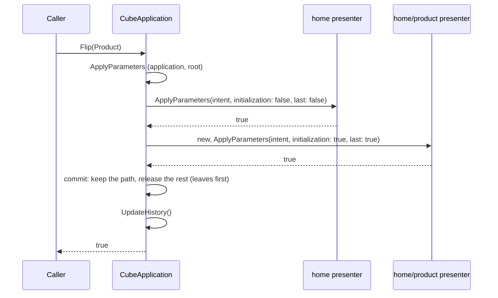

# Navigation

A navigation (a *flip*) brings the application from one face of the cube to another: it walks the path of the
requested place from the root down, reusing the presenters already alive on that path, creating the missing ones and
applying the intent to each, then releases whatever is no longer on the path. Because a flip touches many presenters
and may wait on I/O at any level, `CubeApplication` treats it as a transaction with explicit guarantees: it commits as
a whole, rolls back as a whole, and never leaks or double-releases a presenter.

## Starting a flip

```csharp
await App.Flip(CartKeys.Place);                                          // from the current state
await App.Flip(ProductKeys.Place, i => i.SetParameter("pr-id", 7L));     // with something set
await new ProductKeys(App) { ProductId = 7 }.Flip();                  // the same, through a keys class
await App.FlipToIntent(intent);                                       // an intent built elsewhere
await App.FlipToIntentString("home/product?pr-id=7");                 // an address
```

All of them return `Task<bool>`: `true` when the committed face is the place the intent asked for; `false` when a
presenter stopped the walk earlier, redirected elsewhere, or the request was discarded while waiting (see below).

## The walk



- The application presenter's `ApplyParameters` runs first on every flip, as the root of the path. Returning `false`
  there stops the walk at the bare root.
- For each place of the path: a live presenter is reused (`initialization: false`); otherwise the place's factory
  creates one (`initialization: true`); a place with no factory is walked through.
- The application's set of live presenters is not touched until commit. The walk works on a copy.

## The guarantees

**What `ApplyParameters` returns decides how far the face goes:**

- `true`: accepted; the walk goes on to the next level.
- `false`: **accepted, but stop here**. The face is committed up to this presenter, even if the intent asked for
  something deeper, and `LastPlace` becomes this presenter's place — not the leaf that was asked for. The address
  published is that place's.
- An exception: the only way to refuse the navigation and keep the previous state. The flip rolls back and the
  exception is rethrown to the caller of `Flip`. (Inside a guarded action, it reaches `Unexpected`.)

**Release:**

- Every presenter created gets `Release()` exactly once: at commit if it is off the committed path, at rollback if
  the attempt created it, or when the application is released.
- Release order is leaves first.
- A failing `Release()` is reported through `Unexpected` and does not stop the others.

**Rollback:**

- The presenters that were alive before the attempt are re-applied with the *source* intent (the state before the
  flip, built from their own `PublishParameters`), root first, with `initialization: false`.
- The presenters created by the attempt are released.
- An error while restoring one presenter is reported and does not stop the restoration of the others.
- A navigation requested while rolling back is ignored (and logged).

**History:** the address is republished at the end of every attempt, on success and on failure.

## Redirects

A presenter may decide, inside its `ApplyParameters`, that the user should be somewhere else. It starts another
navigation and returns `false`:

```csharp
if (keys.ProductId is not { } productId)
{
    await App.FlipToIntent(intent.Redirect(HomeKeys.Place)); // nothing to show: back to the panels
    return false;
}
```

- `intent.Redirect(place)` is a new intent for another place carrying a copy of the parameters **and attributes**
  in transit (slots included), so the target finds what the levels above prepared.
- A redirect does not start a second attempt: it **retargets** the running one. The walk that was interrupted stops,
  and the new target is walked from the root.
- Presenters created by the interrupted walk are reused if the new path goes through their place; the others are
  released at commit (or at rollback if the redirect fails).
- If the redirect target throws, the whole attempt rolls back to the state before the first flip.
- Cycles are stopped: more than 5 visits to the same path in one attempt, or more than 10 redirects, throw
  `CubeNavigationException` and roll back.

## Concurrent requests

A flip can wait on I/O, so a second request may arrive while one is running. The rule depends on where it comes from:

- **From inside the running attempt** (a presenter redirecting from its `ApplyParameters`): it retargets the attempt,
  as above.
- **From outside** (a click, a history change, work that an earlier attempt started and left running): it **waits**
  for the running attempt to end, then runs.
- **Only the latest waits.** A request already waiting is discarded when another arrives; its task completes with
  `false`.
- **If the running attempt fails**, the waiting request is discarded too.
- A waiting request is built from the state at the moment it runs, not at the moment of the click.

"Inside" is tracked by an ambient context that flows through every `await` of the attempt's `ApplyParameters` calls.
A load started with `_ = Load()` during one attempt and still running later carries a context that is no longer the
running one, so it counts as outside.

## Starting the application: KickStart

```csharp
public Task Start() => InvokeAsync(async () =>
{
    Subject = await ResumeSession();
    InstallCodec(Subject);        // before KickStart: it reads the address first
    await KickStart(HomeKeys.Place);
    if (!HasNavigated)
    {
        await new HomeKeys(this).Flip();  // an empty address
    }
});
```

`ApplicationPresenter.KickStart(safePlace)`:

1. reads `History.Location` into an intent;
2. calls the application's own `ApplyParameters` once with `initialization: true, last: true`;
3. if the address names a deeper place, flips there (the application's `ApplyParameters` runs again, now with
   `initialization: false`, as the root of that walk);
4. on any failure, reports it through `Unexpected` and flips to `safePlace` instead, from the current state — without
   the parameters of the address that failed.

With an empty address `KickStart` stays at the root and creates no presenter. Because of step 2, an application
presenter must not navigate from its `ApplyParameters` merely because `last` is `true` during initialization.

## LastPlace and HasNavigated

- `LastPlace` is the place last committed, or `RootPlace` before any navigation.
- `HasNavigated` tells "at the root" from "nowhere yet". It is `false` during the first navigation too, including for
  every presenter a deep link builds on the way in.
- `IsFlipping` is `true` while an attempt is in progress; `PresenterCount` and `GetPresenter(place)` read what is
  alive.

A dialog that wants to return where the user came from can remember it on initialization:

```csharp
if (initialization && App.HasNavigated)
{
    _previousIntent = App.NewFlipIntent(App.LastPlace);
}
```

## Guards

A guard is a presenter high in the tree that refuses to build the levels below it unless a condition holds. It is
just a redirect:

```csharp
public override async Task<bool> ApplyParameters(FlipIntent intent, bool initialization, bool last)
{
    // Nothing under home without a session. Redirect with the intent in transit.
    if (App.Subject is not { } subject)
    {
        await App.FlipToIntent(intent.Redirect(LoginKeys.Place));
        return false;
    }

    var keys = new HomeKeys(App, intent);
    keys.ParentSlot(Scope);
    // ...
    return true;
}
```

Every place under `home` is protected, whether it is reached by a click, a pasted link or Back: they all walk
through `home` first. The redirect keeps the attributes of the original intent, so the login presenter still finds the
slot the application offered, and the parameters that were in transit travel along with it.

## See also

- [Architecture](architecture.md)
- [Update cycle](update-cycle.md)
- [Dispatcher](dispatcher.md)
- [History](history.md)
- [Domain](domain.md), [Persistence](persistence.md), [Transactions](transactions.md),
  [Protected repositories](protected-repositories.md), [Remote](remote.md)
- [Getting started](../getting-started.md)
