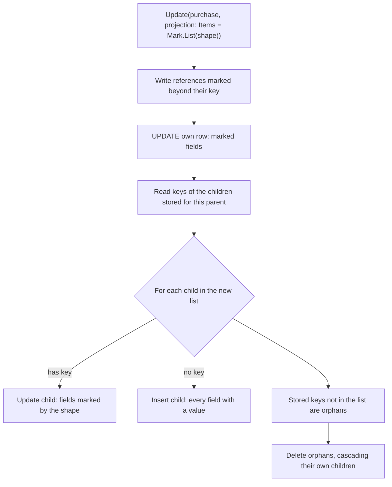

# Persistence

`Wdc.Persistence` implements the [repository contract](domain.md#the-repository-contract) over a relational database without SQL written per entity. You describe once how an entity is stored, in an `EntityMapping`, and `SqlRepository` derives every operation from it: each fetch is a single statement that returns rows already shaped as JSON by the projection, criteria are translated by a function the repository owns, and writes follow the projection into references and collections, in one transaction. PostgreSQL and SQL Server are supported through dialects.

## Creating the database

```csharp
var dataSource = NpgsqlDataSource.Create(connectionString);
Database database = PostgreSql.CreateDatabase(dataSource, schema: "shopping");
// or: Database database = SqlServer.CreateDatabase(connectionString, schema: "shopping");

var products = new ProductRepository(database);
var purchases = new PurchaseRepository(database);
var items = new PurchaseItemRepository(database);
```

- `Database` holds the dialect, the way to open a pooled connection, the optional schema and the ambient transaction. It is also the `ITransactionService` (see [transactions](transactions.md)).
- `PostgreSql.CreateDatabase` takes an `NpgsqlDataSource` that you own and dispose. `SqlServer.CreateDatabase` uses SqlClient's pool for the connection string.
- A repository registers itself with its `Database` when constructed. A cascade writes each child through that child's repository, so every repository a cascade can reach must be created on the same `Database`; otherwise the write fails with `InvalidOperationException` naming the missing one.
- `Database.Execute(SqlStatement)` and `Database.Scalar(SqlStatement)` run hand-written statements (DDL, bulk updates) inside the ambient transaction or one of their own. Parameters are referenced as `@p0`, `@p1`…

## Mapping an entity

```csharp
public sealed class PurchaseRepository(Database database)
    : SqlRepository<Purchase, PurchaseCriteria, long>(database, Mapping), IPurchaseRepository
{
    public static readonly EntityMapping<Purchase> Mapping = EntityMapping.For(Purchase.Model, "purchase", "pu")
        .Key("id", generated: true)
        .Column("buyDate", "buy_date")
        .Reference("user", "user_id", () => UserRepository.Mapping)
        .Collection("items", "purchase_id", () => PurchaseItemRepository.Mapping, cascadeDelete: true)
        .Conditions<PurchaseCriteria>(Conditions)
        .Ordering<PurchaseOrderBy>(o => o switch
        {
            PurchaseOrderBy.NewestFirst => [SortSpec.Desc("id")],
            PurchaseOrderBy.MostRecentPurchaseFirst => [SortSpec.Desc("buy_date"), SortSpec.Desc("id")],
            _ => [SortSpec.Asc("id")],
        })
        .Build();
    // Conditions: see below.
}
```

| Builder call | Meaning |
|---|---|
| `EntityMapping.For(model, table, aliasPrefix)` | Starts the mapping. The prefix names the aliases used in generated SQL. |
| `Key(column, generated)` | The key's column (the field name by default). With `generated: true` the database assigns it and an insert never writes it. Required. |
| `Column(field, column)` | A scalar field's column (the field name by default). |
| `Reference(field, foreignKeyColumn, () => OtherRepository.Mapping)` | A reference stored as a foreign key in this table, pointing at the other entity's key. |
| `Collection(field, childForeignKeyColumn, () => ChildRepository.Mapping, cascadeDelete)` | Children that point at this entity through their own foreign-key column. |
| `Conditions<TCriteria>(fn)` | How this repository translates its criteria. |
| `Ordering<TOrderBy>(fn)` | The columns of each named ordering. The key is always added as the last tie-breaker. |

Rules:

- Mappings refer to each other through delegates, resolved lazily, so cycles (purchase → items → purchase) are fine.
- The field must exist in the model with the matching kind, and can be mapped only once; violations throw when the mapping is built.
- A field left unmapped is never read nor written.
- With `cascadeDelete: true` the children belong to the parent and are deleted with it. Without it the collection is a *view* (the sales of a product): a delete leaves the children alone, and a foreign-key constraint will refuse to delete a parent that still has them.
- A mapping without `Conditions` cannot filter: any criteria with a filter throws.

## Reads: one statement, JSON rows

`Fetch`, `FetchPage`, `FetchById` and `Count` each run one SQL statement:

- The select list is one JSON object per row, built by the database from the projection, and read back with the same `JsonEntityCodec<T>` the REST layer uses.
- Only projected columns are selected; the key is always included.
- A reference asked only for its key is read from the foreign-key column of the row itself. A reference marked beyond its key becomes a correlated subquery on the referenced table.
- A collection becomes a correlated subquery returning a JSON array (an empty array when there are no children), ordered by the child's ordering. The filter carried by `Mark.List(shape, criteria, …)` is translated by the child mapping's own `Conditions`.
- A collection slice (`limit`/`offset`) is applied per parent, as `key IN (SELECT key … ORDER BY … LIMIT/OFFSET)`. It needs a single-column key on the child.
- There is no N+1 and no join explosion, whatever the depth of the projection.
- `FetchPage` runs `Count` and then, if anything matched, `Fetch`.

## Translating criteria

Each repository owns the translation of its criteria, as a function from the criteria and a `FilterContext` to a SQL fragment:

```csharp
private static ISqlFragment? Conditions(PurchaseCriteria criteria, FilterContext t) => Sql.And([
    t.Translate("id", criteria.PurchaseId),
    t.Translate("user_id", criteria.UserId),
    t.Translate("buy_date", criteria.BuyDate),
    ExistsItemMatching(criteria, t),
    ExistsUserNamed(criteria, t),
]);
```

- `t.Translate(column, criterion)` translates one criterion on a column of the filtered table; `t.Translate(expression, criterion)` on any expression. Each returns `null` when the criterion asks nothing.
- `Sql.And` and `Sql.Or` skip `null` entries; with nothing left they return `null` (no filter).
- Every criterion that came filled must go through `Translate`. A criterion the function never translates makes the statement fail with an `InvalidOperationException` naming it: a forgotten filter, or a forgotten restriction, is a configuration error, never silently ignored.
- Requests on one field combine with AND, or OR when the criterion is disjunctive; restrictions are added with AND outside that group. `EQ`/`NE` with a `null` value become `IS NULL`/`IS NOT NULL`.
- The same function filters the repository's own queries and every collection of another entity that reaches this one.

### Virtual criteria

A criterion that is not a column of the table, such as the purchases that contain a product, is translated as an `EXISTS` subquery correlated by a foreign key:

```csharp
private static ISqlFragment? ExistsItemMatching(PurchaseCriteria criteria, FilterContext t)
{
    if (!FilterContext.Asks(criteria.ProductId))
    {
        return null;
    }

    var item = t.NewAlias("pi");
    var onProduct = t.Translate(Sql.Column(item, "product_id"), criteria.ProductId);
    return Sql.Exists(w =>
    {
        w.Append("SELECT 1 FROM ").Table("purchase_item").Append(' ').Identifier(item).Append(" WHERE ");
        Sql.And([Sql.Equal(Sql.Column(item, "purchase_id"), t.Column("id")), onProduct])!.Render(w);
    });
}
```

- `FilterContext.Asks(criterion)` is true when the criterion has requests or restrictions; skip the subquery otherwise.
- `t.NewAlias(prefix)` returns an alias unused in the statement; `t.Column(name)` is a column of the filtered table.
- `SqlWriter.Table(name)` qualifies the table with the database's schema and quotes it.

## Dialects

| | PostgreSQL (`PostgreSqlDialect`) | SQL Server (`SqlServerDialect`) |
|---|---|---|
| Row as JSON | `jsonb_build_object`, in blocks joined with `\|\|` | `JSON_OBJECT`, nested JSON wrapped in `JSON_QUERY` |
| Collections | `jsonb_agg` ordered inside the aggregate | `JSON_ARRAYAGG … ORDER BY` |
| Bytes | Base64 (`encode`) | Base64 (`BASE64_ENCODE`) |
| Instants | store in `timestamptz` | store in `datetimeoffset` |

The SQL Server dialect targets SQL Server 2025. `ISqlDialect` lists what changes between databases: quoting, JSON construction, LIKE, booleans, slicing, `DELETE` and the insert that returns the generated key.

## Writes in cascade

A write follows its projection. Everything runs in one transaction (the ambient one, or one opened for the write).

**Insert** (`Insert(bean, projection)`):

1. Each reference that the projection marks beyond its key is written first: inserted when the referenced bean has no key (the foreign key then points at it), updated in its marked fields otherwise. A reference marked only by its key writes just the foreign key.
2. The row is inserted and read back, completing the bean with the generated key and database defaults.
3. Each collection the projection marks is inserted, every child pointed at the new parent. Without a projection, every collection that holds a non-empty list is inserted, but references are not written beyond their foreign key.
4. A child is inserted with every field that holds a value, whatever shape the projection gives.

**Update** (`Update(newBean, oldBean, projection)`): references as in insert, then the row's own columns, then each marked collection as its full state.



Rules:

- The cascade happens only when a projection is given. A collection the projection does not mark is untouched, even if the bean carries a list.
- A marked collection holding an empty list means "no children": all are deleted.
- To be written in cascade, the child mapping must map a reference back to the parent on the same foreign-key column (`PurchaseItem.purchase` on `purchase_id`). The cascade sets that reference on each child.
- Children are written through their own repository's `Insert` and `Update`, so overrides on that repository (validation, defaults) apply to them too. Orphans are removed by key, which cascades their own `cascadeDelete` collections.
- **Delete**: without any `cascadeDelete` collection, `Delete` is a single `DELETE … WHERE`. Otherwise it selects the matching keys, deletes the children of those keys first (recursively), then the rows.

```csharp
var purchase = new Purchase
{
    User = ana,
    BuyDate = DateTimeOffset.UtcNow,
    Items = [new PurchaseItem { Product = ball, Amount = 2, Price = 10m }],
};
await purchases.Insert(purchase, new Purchase
{
    User = new User(), // key only: just the foreign key
    BuyDate = Mark.Instant,
    Items = Mark.List(new PurchaseItem { Amount = Mark.Int32, Price = Mark.Decimal, Product = new Product() }),
});
```

## The cascade guard

Rules written per entity (who may insert an item, what price it gets) must also hold for children written in cascade. `ICascadeGuard` is the hook for that:

```csharp
public interface ICascadeGuard
{
    Task BeforeInsert(Type entityType, object entity, CancellationToken cancellationToken);
    Task BeforeUpdate(Type entityType, object entity, object projection, CancellationToken cancellationToken);
    Task BeforeDelete(Type entityType, IReadOnlyList<object> keys, CancellationToken cancellationToken);
}
```

- `CascadeGuard.Run(guard, work)` installs a guard for the calling flow; `CascadeGuard.Current` reads it; `CascadeGuard.Suspend(work)` runs `work` with none. Like the ambient transaction it lives in an `AsyncLocal` and follows `await`.
- The repository calls the guard before each child it inserts, updates or deletes in cascade: referenced rows, collection children, orphans and `cascadeDelete` children.
- The entity the caller wrote directly is not reported: its own rules already ran.
- The guard may complete the child (a price taken from the product) or refuse by throwing, which rolls the whole write back.
- The protected repositories install a guard that applies each child entity's policy. See [protected repositories](protected-repositories.md).

## Subclassing a repository

`SqlRepository` is meant to be subclassed. Every contract method is `virtual`, and `Database`, `TableMapping`, `Codec`, `Model`, `Select(...)` and `ProjectionOf(criteria)` are available to subclasses.

```csharp
public override Task<bool> Insert(Purchase bean, Purchase? projection = null,
    CancellationToken cancellationToken = default)
{
    ArgumentNullException.ThrowIfNull(bean);
    if (bean.BuyDate is null)
    {
        throw new InvalidRequestException("a purchase needs its date of purchase");
    }

    return base.Insert(bean, projection, cancellationToken);
}
```

- Validation in an override applies both to direct calls and to cascades that reach this entity.
- An override may change how the entity is written: the Shopping amendment repository calls `base.Insert(bean, null, …)` so an amendment is always written whole, whatever projection arrives.
- Extra operations compose the inherited ones: `ProductRepository.FetchImage` is `FetchById(id, new Product { Image = Mark.Bytes })`.

## See also

- [Architecture](architecture.md)
- [Update cycle](update-cycle.md)
- [Dispatcher](dispatcher.md)
- [Navigation](navigation.md)
- [History](history.md)
- [Domain model](domain.md)
- [Transactions](transactions.md)
- [Protected repositories](protected-repositories.md)
- [Remote repositories and transactions](remote.md)
- [Getting started](../getting-started.md)
