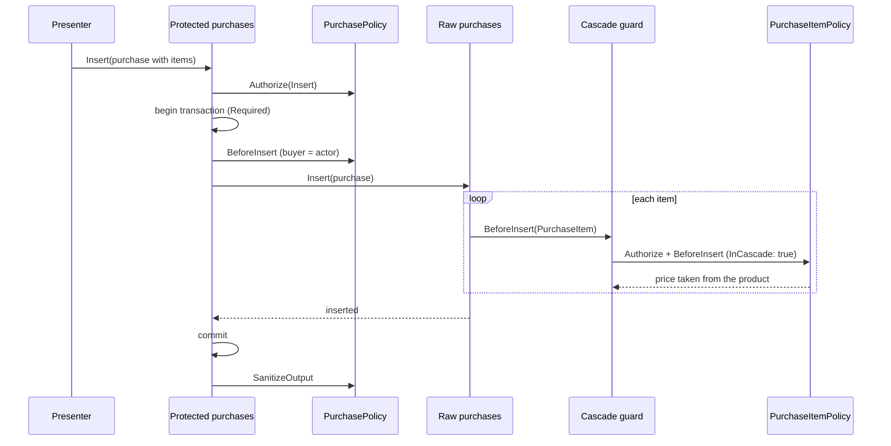

# Protected repositories

A protected repository is a repository seen by whoever is acting. It implements the same `IRepository<TEntity, TCriteria, TKey>` contract as the raw repository it wraps, and sends every operation through the entity's `RepositoryPolicy`: who may do it, which rows they reach, which fields they read, and what each write must satisfy. Every host hands protected repositories to a session (a Blazor Server circuit, a REST request, a test), so the rules are declared once, in the domain, and hold the same way everywhere. Presenters do not check permissions; they use the repositories they were given and react to the exceptions those raise.

All framework types on this page live in the `Wdc.Domain` namespace (`src/Wdc.Domain/Security`).

## Who is acting

- `Actor` is an id and a set of roles, both plain strings written by the application. The framework only compares them (`actor.HasRole("Super")`); what a role may do is the application's business.
- `IActorSource` has one member, `Actor? Current`. A protected repository asks it at *every call*, so the actor can change during a session (login, logout) without rebuilding anything.
- `ActorSource` is the settable implementation: `new ActorSource()` starts with nobody; its owner sets `Current`.
- Where the actor comes from depends on the host:
  - on a server, per request, from the request's token;
  - in Blazor Server, per circuit, set by the login and cleared by the logout;
  - in a test, by whoever builds the session.
- `null` means nobody. Nothing protected is served to nobody: every operation throws `AuthenticationException` before touching the database.

## The policy

`RepositoryPolicy<TEntity, TCriteria, TKey>` is built from the entity model and a criteria factory, and every rule is an optional delegate. One instance serves every session: the policy holds no actor, it receives one in a `PolicyContext`.

`PolicyContext(Actor Actor, bool InCascade)` tells a rule who is acting and whether the entity is being written because another entity's projection asked for it (a child inserted with its parent, or an orphan deleted by the parent's full-state update).

`RepositoryOperation` is what `Authorize` is asked about: `Insert`, `Update`, `Delete`, `Count`, `Fetch`, `FetchPage`, `FetchById`.

| Hook | Signature (after the context) | Purpose |
|---|---|---|
| `Authorize` | `RepositoryOperation` | Throw `AccessDeniedException` unless the actor may do the operation. |
| `Scope` | `TCriteria` | Narrow a criteria to the actor's reach. Applies to reads, update and delete. |
| `RestrictToId` | `(TCriteria, TKey)` (no context) | Restrict a criteria to one key. Required when there is a `Scope` or a `BeforeDelete`. |
| `SanitizeProjection` | `TEntity` (the projection) | Remove from a requested projection what the actor may not read. |
| `SanitizeOutput` | `TEntity` (a result) | Remove from an answer what the actor may not see. |
| `BeforeInsert` | `TEntity, CancellationToken` | Check or complete an entity before it is inserted. |
| `BeforeUpdate` | `TEntity, TEntity written, CancellationToken` | Check an update; `written` marks the fields being written. |
| `BeforeDelete` | `TCriteria, CancellationToken` | Check a delete, given the criteria of the rows that would go (already within reach). |

Rules about writing a scope:

- Narrow with `Restrict`, not `Eq`: `criteria.UserId.Restrict(owner)`. A restriction is combined with AND outside whatever the caller asked on the same field, so a request such as `UserId.Or().IsNotNull()` cannot widen it.
- A policy with a `Scope` or a `BeforeDelete` must set `RestrictToId`; without it, the first operation that needs a single-key criteria throws `InvalidOperationException`.
- The scope and the sanitizers change the criteria and the projection the caller passed. Do not reuse them expecting the original values.

## What each operation does

`ProtectedRepository<TEntity, TCriteria, TKey>` runs the policy in this order (from `ProtectedRepository.cs`):

- **Count**: authorize → scope → inner count.
- **Fetch / FetchPage**: authorize → default the projection to the entity's own fields → `SanitizeProjection` → scope → inner fetch → `SanitizeOutput` on each item.
- **FetchById**: authorize → `SanitizeProjection` → if the policy has a `Scope`, the read goes *through the criteria* (`RestrictToId` + `Scope`, limit 1), so a row outside the reach is simply not found (`null`); without a scope, the inner `FetchById` → `SanitizeOutput`.
- **Insert**: authorize → in a transaction: `BeforeInsert` → inner insert → `SanitizeOutput` on the inserted bean. Insert does not apply the scope: ownership on insert is `BeforeInsert`'s job.
- **Update**: authorize → the key is required (`InvalidRequestException`) → the written marks are computed (the projection given; otherwise the fields that changed against `oldBean`; otherwise the entity's own fields) → in a transaction: the row must be within reach (else `KeyNotFoundException`) → `BeforeUpdate(context, newBean, written)` → inner update.
- **Delete**: authorize → a criteria with no filter is refused (`InvalidRequestException`), checked *before* the scope is added, since "delete everything I can reach" is not a use case → scope → in a transaction: `BeforeDelete` → inner delete.

Writes run in `Propagation.Required` on the session's `ITransactionService`: they join a transaction already open, or open their own. A hook that throws rolls back everything the write did, cascade children included.

Exceptions, and the HTTP status they become when the call goes over [REST](remote.md):

- `AuthenticationException`: nobody is acting (401).
- `AccessDeniedException`: the actor may not do it (403).
- `KeyNotFoundException`: the row is not within reach (404).
- `InvalidRequestException`: the request itself is wrong (400).

## Cascade: the child's policy applies

A write can reach other entities through its projection: a purchase inserted with its items, a full-state update that deletes orphans. Those children are written by the raw repository, but they do not escape the rules.

- `Protection` is what the protected repositories of one session share: the `IActorSource`, the `ITransactionService`, and a registry of the protected repositories by entity type. Each `ProtectedRepository` registers itself in its constructor.
- During a protected write, a cascade guard (`ICascadeGuard`, carried by `CascadeGuard` in an `AsyncLocal`) is active. The raw repository reports each child it inserts, updates or deletes in cascade; the guard finds the child's protected repository and runs *its* policy with `InCascade: true`:
  - insert: `Authorize(Insert)` → `BeforeInsert`;
  - update: `Authorize(Update)` → within reach → `BeforeUpdate`;
  - delete: `Authorize(Delete)` → for each key, within reach → `BeforeDelete` with that key's criteria.
- A child whose entity has no protected repository in the session is refused with `AccessDeniedException` ("not protected here"): it cannot be written through another entity.
- The entity the caller wrote directly is not reported again; its own rules already ran.
- The guard belongs to the calling flow only. The raw repositories stay free outside a protected write.



## The trusted inside

The raw repositories are the *trusted inside*. Nothing protects them, and they are used where nobody is acting yet, or where the rules themselves need to read:

- **Login.** `LocalAuthentication` reads the user (with the password hash) through the raw store, then sets `ActorSource.Current`. `ShoppingTokens` does the same on the server.
- **Seeding.** Demo data is written through the raw store.
- **Policies.** A rule that needs data reads it through the raw repositories it was given (`PurchasePolicy.Create(store)`), not through the protected ones: the rule must see the truth, not the actor's view.
- **Corrections applied by a rule.** The errata below writes items through the raw store, inside the protected write's transaction.

What a session gets is always protected. A host never hands the raw store to a presenter.

## The Shopping sample

### Permissions

`Shopping.Domain.Security.Permissions` maps each role to grants of the form `entity:verb` (`read`, `write`, `delete`), plus `data:all` (no per-user reach):

| Role | Grants |
|---|---|
| `Super` | `*`, `data:all` |
| `Admin` | `*`, `data:all` |
| `Manager` | read users, products, purchases, items, errata; write/delete products; write errata; `data:all` |
| `Customer` | read users, products, purchases, items, errata; write purchases; write/delete items |

Helpers shared by the policies:

- `Allow(entity)` builds `Authorize`: `Insert`/`Update` need `write`, `Delete` needs `delete`, reads need `read`.
- `ReachOf(actor)` is the actor's id when their reach is their own data, `null` when it is everything; `Reach(context, restrict)` applies it.
- `Maintains(actor)` is true for `Super`, the maintenance role. Business rules hold for every role of the application; only `Super` has some of them relaxed.

### Users: the password never leaves

```csharp
public static RepositoryPolicy<User, UserCriteria, long> Create() => new(User.Model, () => new UserCriteria())
{
    Authorize = Permissions.Allow("user"),
    Scope = (c, criteria) => Permissions.Reach(c, id => criteria.UserId.Restrict(id)),
    RestrictToId = (criteria, id) => criteria.UserId.Restrict(id),
    SanitizeProjection = (_, p) => p.Password = null,
    SanitizeOutput = (_, u) => u.Password = null,
    BeforeInsert = (_, u, _) =>
    {
        u.Password = u.Password is null ? null : PasswordHash.Hash(u.Password);
        return ValueTask.CompletedTask;
    },
    BeforeUpdate = (_, u, written, _) =>
    {
        if (written.Password is not null && u.Password is not null)
        {
            u.Password = PasswordHash.Hash(u.Password);
        }

        return ValueTask.CompletedTask;
    },
};
```

A customer reads only themselves; `Super` reads everyone. Nobody, `Super` included, gets a password back: it is removed from the projection before the query and from each result after it. `BeforeUpdate` uses the `written` marks to hash the password only when it is being written.

### Purchases and items: a purchase made does not change

`PurchasePolicy` and `PurchaseItemPolicy` take the raw store, because their rules read data:

- **Ownership.** `BeforeInsert` sets the buyer to the actor when their reach is their own data, whatever was sent; a role with `data:all` may name the buyer, and defaults to itself.
- **Price.** An item's price comes from its product (`BeforeInsert` reads it through the raw store). Updating `Price` directly is refused.
- **Made means made.** A purchase with a `BuyDate` does not change, is not deleted, and no item enters, changes or leaves it, for every application role. `BeforeUpdate` and `BeforeDelete` check this through the raw store.
- **Cascade.** An item inserted with its purchase (`InCascade`) may enter; one inserted on its own into a purchase already made may not.
- **Relaxed for maintenance.** When `Permissions.Maintains(actor)`, the "already made" checks are skipped. The others still hold: the price still comes from the product, the password still never leaves.

```csharp
BeforeDelete = async (c, criteria, ct) =>
{
    if (!Permissions.Maintains(c.Actor) && await AnyMade(store, criteria, ct))
    {
        throw new AccessDeniedException("The purchase was already made: it is not deleted.");
    }
},
```

The criteria `BeforeDelete` receives is already within the actor's reach, so `AnyMade` only looks at rows the actor could delete.

### Errata: a correction through the trusted inside

Since an application role can never update a purchase already made, corrections are a separate entity, `PurchaseAmendment`. Inserting one *is* the correction; `Admin` and `Manager` may do it (`purchase-amendment:write`). `PurchaseAmendmentPolicy.BeforeInsert`:

1. Refuses an errata inserted in cascade (it is inserted by itself, never with its purchase) and requires a purchase, a reason and at least one line.
2. Locks the purchase: it reads it within the actor's reach (else `KeyNotFoundException`), requires it to be made, and writes `BuyDate` back to the value it holds through the raw store. Writing the row takes its lock in every database, so two errata of the same purchase are applied one after the other, each on what the other left.
3. Validates each line against the current items: the item belongs to the purchase, appears once, its amount only goes down (0 removes it), and not every item is removed.
4. Applies the correction through the raw store (`store.PurchaseItems.Update` or `Delete`), in the insert's transaction. The generic item update stays refused to every application role.
5. Fills the record from the data, whatever was sent: each line's previous amount, price and product, the date from the `TimeProvider`, and the author from the actor.

The lines are then inserted in cascade with the errata and go through `PurchaseAmendmentLinePolicy`, which admits a line only `InCascade` (or for maintenance). Once inserted, an errata and its lines do not change and are not deleted, except by `Super`. The author is shown only to roles that reach all the data.

### Wiring a session

`ShoppingProtection.Protect` builds one `Protection` and the protected repository of every entity, so cascades between them are guarded:

```csharp
public static ShoppingRepositories Protect(ShoppingRepositories store, IActorSource actors, TimeProvider? time = null)
{
    var protection = new Protection(actors, store.Transactions);
    return new ShoppingRepositories(
        new ProtectedUserRepository(store.Users, protection),
        new ProtectedProductRepository(store.Products, protection),
        new ProtectedPurchaseRepository(store.Purchases, store, protection),
        new ProtectedPurchaseItemRepository(store.PurchaseItems, store, protection),
        new ProtectedPurchaseAmendmentRepository(store.Amendments, store, time ?? TimeProvider.System, protection),
        new ProtectedPurchaseAmendmentLineRepository(store.AmendmentLines, protection),
        store.Transactions);
}
```

Each `Protected*Repository` is a one-line subclass that also implements the application's repository interface (`IPurchaseRepository`). Subclass `ProtectedRepository` further to protect what an application repository adds: `ProtectedProductRepository.FetchImage` calls `Enter(RepositoryOperation.FetchById)` before reading the image.

In Blazor Server, one actor and one set of protected repositories per circuit:

```csharp
builder.Services.AddScoped<ActorSource>();
builder.Services.AddScoped(sp => ShoppingProtection.Protect(store.Repositories, sp.GetRequiredService<ActorSource>()));
builder.Services.AddScoped<IAuthentication>(sp => new LocalAuthentication(store.Repositories,
    sp.GetRequiredService<ActorSource>(), id => HistoryKeys.Derive(historyMaster, id)));
```

On the REST server, one per request, with the actor read from the JWT (`ShoppingTokens.ActorOf(user)`); see [Remote repositories](remote.md).

## Testing the rules

`SecurityTestsBase` and `ErrataTestsBase` in `Shopping.Presentation.Tests` are written once and run twice: in process (`SecurityTests`, as Blazor Server runs them) and through the HTTP server (`SecurityHttpTests`). They log in as demo users and assert on the raw store, for example that a disjunctive criteria does not widen a customer's reach, or that a purchase made keeps its date for `Customer` and `Admin` alike.

## See also

- [Architecture](architecture.md)
- [Domain](domain.md)
- [Persistence](persistence.md)
- [Transactions](transactions.md)
- [Remote repositories](remote.md)
- [Update cycle](update-cycle.md), [Dispatcher](dispatcher.md), [Navigation](navigation.md), [History](history.md)
- [Getting started](../getting-started.md)
