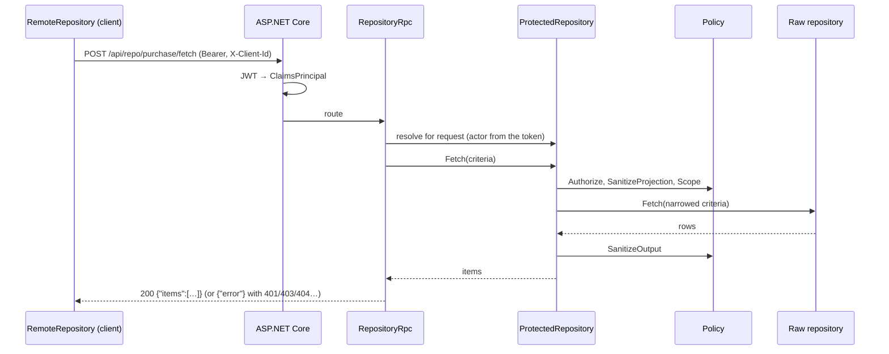

# Remote repositories

The repository and transaction contracts (`IRepository<TEntity, TCriteria, TKey>` and `ITransactionService`) have a second implementation that runs over HTTP. A client process (a WebAssembly app in the browser, a desktop app) gets `RemoteRepository` and `RemoteTransactionService` instances; the server serves each repository as a set of JSON routes and runs the calls against [protected repositories](protected-repositories.md) for whoever the request authenticated. Presenters and use cases do not know which side they are on: the same code, and the same tests, run locally and through HTTP.

Three packages divide the work:

| Package | Contents |
|---|---|
| `Wdc.Rest` | What both sides share: `RepositoryWire` (the JSON bodies), `RestNames` (routes and headers), `RestErrors` (exception ↔ status), `RemoteCallException`. |
| `Wdc.Rest.Server` | ASP.NET Core endpoints: `RepositoryRpc`, `RestTransactions`, the remote transaction coordinator and routes, `AddCubeRest`. |
| `Wdc.Rest.Client` | `RestClient`, `RemoteRepository`, `RemoteTransactionService`. |

The wire format is shared with the Kotlin implementation of Cube: a client of one can talk to a server of the other.

## The wire

`RestNames` holds the names both sides use:

- operations: `insert`, `update`, `delete`, `count`, `fetch`, `fetch-page`, `fetch-by-id`;
- headers: `X-Tx-Id` (the remote transaction a request belongs to) and `X-Client-Id` (one client instance, part of a remote transaction's owner);
- `TransactionBase` = `/api/tx`.

`RepositoryWire<TEntity, TCriteria>` writes and reads the bodies from the entity model, so the client and the server need nothing but the same model:

- **Queries** (`count`, `fetch`, `fetch-page`, `delete`): one object with the criteria's fields, `orderBy`, `projection` and the slice (`offset`/`limit` or `page`/`pageSize`). Unknown keys are ignored; an unknown ordering is a 400.
- **insert**: `{"entity":{…},"projection":{…}}`, or the entity alone → `{"success":true,"id":7,"entity":{…}}`.
- **update**: the fields to write, explicit nulls included, plus the key → `{"success":true}`. Fields absent from the body are left untouched.
- **delete**, **count** → `{"count":N}`; **fetch** → `{"items":[…]}`; **fetch-page** → `{"items":[…],"totalItems":N}`.
- **fetch-by-id**: `{"id":7,"projection":{…}}` → the entity, or 404.
- **Errors**: `{"error":"…"}`.

A fetch with a projection, as it goes on the wire:

```
POST /api/repo/product/fetch
{"productId":12,"projection":{"id":1,"name":"~"}}

200 {"items":[{"id":12,"name":"Soccer ball"}]}
```

## The server

### RepositoryRpc

`RepositoryRpc<TEntity, TCriteria, TKey>` maps one repository under a base path. Its last argument is a function that returns the repository *for this request*:

```csharp
new RepositoryRpc<Purchase, PurchaseCriteria, long>("/api/repo/purchase", Purchase.Model, () => new PurchaseCriteria(),
    c => c.RequestServices.GetRequiredService<ShoppingRepositories>().Purchases).Map(app);
```

Routes under the base path:

- `POST count`, `fetch`, `fetch-page`, `fetch-by-id`, and `GET {id}` (the entity's own fields);
- `POST insert`, `update`, `delete`, unless `Writes = false` (then the repository may be an `IReadOnlyRepository`).

`RepositoryRpc` is only the wire. It decodes the body, calls the repository, and encodes the answer. It does not decide who may do what: the repository it resolves is a `ProtectedRepository` built for the request's actor, so authorization, reach, field sanitizing and write checks are the same as in any other host. What it adds is about the transport:

- A query with no projection gets the repository's own-fields projection.
- `fetch` with a `limit` above `RestServerOptions.MaxItems` (default 1,000) is a 400. A `fetch` with no limit that matches more than `MaxItems` rows is a 400 too ("page the request"), never silently cut.
- `fetch-page` needs `pageSize` between 1 and `MaxItems`.
- `update` without the key, and `delete` with no filter, are 400.
- Bodies larger than `MaxBodyBytes` (default 16 MB) are refused.

### Errors

`RestHttp.Respond` turns exceptions into statuses with `RestErrors.ToResponse`; the client turns them back with `RestErrors.FromResponse`. The table is the same on both sides:

| Exception | Status |
|---|---|
| `InvalidRequestException` (also `JsonException`, `FormatException` on the server) | 400 |
| `AuthenticationException` | 401 |
| `AccessDeniedException` | 403 |
| `KeyNotFoundException` (also a `null` answer: not found) | 404 |
| `TransactionConflictException` | 409 |
| `TransactionNotFoundException` | 410 |
| `TooManyRequestsException` (also `TransactionLimitExceededException`) | 429, with `Retry-After` when known |
| anything else | 500 "Internal server error" (detail logged, not sent); `RemoteCallException` on the client |

### Transactions per request

`RestTransactions.Run` decides the transaction a request runs in:

1. With `X-Tx-Id`: inside that remote transaction. Reads too, so they see the transaction's own writes.
2. A write without the header while the same owner has a remote transaction open: refused with 409 (`RefuseWritesOutsideOpenTransaction`, on by default). It is almost always a lost header.
3. Any other write: one transaction for the request (`Required` on the server's `ITransactionService`). Reads: none.

The protected repository's own `Required` joins whichever transaction is active.

### Remote transactions

A client can hold a transaction open across several requests. `MapRemoteTransactions()` adds:

- `POST /api/tx/begin` → `{"txId":"…"}`;
- `POST /api/tx/commit` and `/api/tx/rollback`, with `X-Tx-Id` → `{"status":"committed"}` / `{"status":"rolledback"}`;
- `GET /api/tx/status`, with `X-Tx-Id` → `{"status":"open"|"committed"|"rolledback"|"unknown"}`.

`RemoteTransactionCoordinator` keeps them:

- Each holds its own database connection (`IDetachedTransactionSource`) and serves one request at a time: a request or a commit while another request runs is refused with 409; a rollback then holds at once, and the connection rolls back when the running request ends.
- Each belongs to an owner, by default `user:<id>|client:<X-Client-Id>` (`RestServerOptions.OwnerOf`). Another owner using it gets 403. The cap of open transactions counts the user, across its clients (`RestServerOptions.QuotaOf`).
- A request that fails inside dooms it: a later commit rolls back and is refused with 409, which the client throws as `TransactionSystemException`.
- Repeating an outcome answers the same; the opposite outcome is a 409; an unknown, expired or finished transaction is a 410.
- Limits (`RemoteTransactionOptions`): `MaxOpen` (128), `MaxOpenPerOwner` (16, counted per user across its clients), beyond which `begin` answers 429; `IdleTimeout` (60 s) and `MaxLifetime` (10 min), after which a reaper rolls back.

Registration: `services.AddCubeRest(...)` registers the options and, unless `remoteTransactions: false`, the coordinator and its reaper (it needs an `IDetachedTransactionSource` in the container).

## The client

### RestClient

`RestClient` wraps an `HttpClient` whose `BaseAddress` is the server. On every call it sends JSON, `X-Client-Id`, the bearer token, and `X-Tx-Id` when the calling flow is inside a remote transaction. An error answer becomes the exception of the table above. `RestClientOptions`:

- `AccessToken`: returns the bearer token to send, or `null` for none.
- `RefreshAccess`: called after a 401; renews the token and says whether to repeat the call (once). If it returns `false`, the call throws `AuthenticationException`.
- `ClientId`: this client instance (a new GUID by default).

### RemoteRepository

`RemoteRepository<TEntity, TCriteria, TKey>` implements `IRepository` over the routes. It behaves like the local repository where the caller can tell:

- `Insert` copies back what the server stored and the caller did not write (the key, defaults).
- `Update` sends the same choice of fields the local repository would write (the projection, else what changed against `oldBean`, else the own fields), and returns `false` without a call when there is nothing to write.
- `FetchById` returns `null` on 404; `Delete` with no filter is refused before the call.

An application repository subclasses it and adds its own calls:

```csharp
public sealed class RemoteProductRepository(RestClient client)
    : RemoteRepository<Product, ProductCriteria, long>(client, "/api/repo/product", Product.Model, () => new ProductCriteria()),
        IProductRepository
{
    public async Task<byte[]?> FetchImage(long productId, CancellationToken cancellationToken = default)
    {
        // 404: no such product (KeyNotFoundException); 204: a product with no image.
        var body = await Client.Get($"{BasePath}/{productId}/image", cancellationToken);
        return body.Length == 0 ? null : body;
    }
}
```

### RemoteTransactionService

`RemoteTransactionService` implements `ITransactionService` over `/api/tx`, with the same propagations as the local one. The open transaction follows the calling flow (an `AsyncLocal`), and every call of the same `RestClient` in that flow carries its `X-Tx-Id`.

- If the work throws, the transaction is rolled back and the work's exception is rethrown unchanged.
- If the server rolled back because a request inside it failed (even one the caller caught), the commit throws `TransactionSystemException` instead of reporting a success that did not happen.
- If the answer to the commit is lost, the client asks `/api/tx/status` before reporting anything.

```csharp
await remote.Transactions.Required(async _ =>
{
    await remote.Products.Insert(new Product { Name = "pending", Price = 1m }, cancellationToken: ct);
    var count = await remote.Products.Count(new ProductCriteria().Name.Eq("pending"), ct); // sees its own write
}, ct);
```

## A request, end to end



## The Shopping sample

### Server

`ShoppingApi.AddShoppingApi` builds the protected repositories once per request, for the actor in the token:

```csharp
services.AddScoped(sp => ShoppingProtection.Protect(store.Repositories,
    new ActorSource(sp.GetRequiredService<IHttpContextAccessor>().HttpContext?.User is { } user
        ? ShoppingTokens.ActorOf(user)
        : null)));
services.AddSingleton<ITransactionService>(store.Database);
services.AddSingleton<IDetachedTransactionSource>(store.Database);
services.AddCubeRest();
```

- `ShoppingTokens.ActorOf` reads the `sub` claim as the user id and the `role` claims as roles; no valid token, no actor.
- `MapShoppingApi` adds authentication, a guard that answers 401 for any `/api` route without a session (except `/api/auth` and product images), the auth routes, `MapRemoteTransactions()`, and one `RepositoryRpc` per entity under `/api/repo/<entity>`.
- `AuthRoutes` serves a challenge login: `GET /api/auth/challenge` returns a nonce, salt and iterations; the client proves the password with a digest (the password never leaves the client); `login` and `refresh` return an access token and a refresh token; `logout` revokes the refresh token. `ShoppingTokens` reads users through the raw store, since nobody is acting yet.

### Client

`ShoppingClient` assembles the same `ShoppingRepositories` the presentation gets locally, with remote parts, and wires the token hooks to `RemoteAuthentication`:

```csharp
var options = new RestClientOptions
{
    AccessToken = _ => ValueTask.FromResult(_credentials.AccessToken),
    RefreshAccess = ct => new ValueTask<bool>(Authentication!.RefreshAccess(ct)),
};
Rest = new RestClient(http, options);
Authentication = new RemoteAuthentication(http, Rest, _credentials);
Repositories = new ShoppingRepositories(
    new RemoteUserRepository(Rest), new RemoteProductRepository(Rest), new RemotePurchaseRepository(Rest),
    new RemotePurchaseItemRepository(Rest), new RemotePurchaseAmendmentRepository(Rest),
    new RemotePurchaseAmendmentLineRepository(Rest), new RemoteTransactionService(Rest));
```

### What changes for the presentation

Nothing. `RootPresenter` receives `ShoppingRepositories` and an `IAuthentication` in every host:

- **Blazor Server**: protected repositories over the database, `LocalAuthentication`.
- **WebAssembly** (`Shopping.Wasm`): `new ShoppingClient(new HttpClient { BaseAddress = … })`, registering `client.Repositories` and `client.Authentication`; the server that serves the page is the API.
- **Desktop** (`Shopping.Avalonia`): the same `ShoppingClient`, pointed at the server's address, with the Avalonia dispatcher.

The presentation tests prove it. Each `*TestsBase` class in `Shopping.Presentation.Tests` runs twice: once in process, once through `ShoppingHttpFixture`, which starts the real Shopping server in memory (`TestServer`) over the same database and connects each application instance as a new `ShoppingClient`. `SecurityHttpTests`, `ErrataHttpTests`, `BuyingHttpTests`, `HomeHttpTests`, `SessionHttpTests` and the others are one-line subclasses. At the framework level, `PostgreSqlHttpRepositoryTests` and `SqlServerHttpRepositoryTests` run the whole repository contract through the routes, and `RestContractTests` checks the wire, the limits and the remote transactions.

## See also

- [Architecture](architecture.md)
- [Domain](domain.md)
- [Persistence](persistence.md)
- [Transactions](transactions.md)
- [Protected repositories](protected-repositories.md)
- [Update cycle](update-cycle.md), [Dispatcher](dispatcher.md), [Navigation](navigation.md), [History](history.md)
- [Getting started](../getting-started.md)
