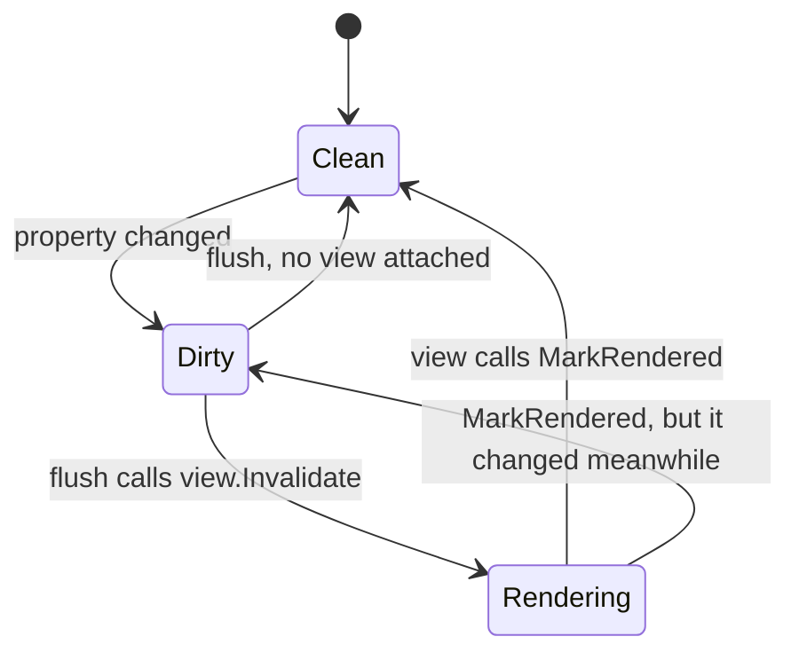

# Update cycle

Presenters change scopes; views draw them. Between the two sits the update cycle: a scope that changes is marked
dirty, dirty scopes are handed to their views in short windows (about 16 ms), and a scope only becomes clean again
when its view confirms that the screen shows it. This keeps a burst of changes from becoming a burst of redraws, makes
the presentation layer responsible for not overloading the rendering technology, and guarantees that a change made
while a view is still drawing is never lost.

## Observed properties

Declare scope properties with `Set(ref field, value)` (C# 14 `field` keyword):

```csharp
public sealed class FooterScope : Scope
{
    public int Count { get; set => Set(ref field, value); }

    public string ActiveTodoWord { get; set => Set(ref field, value); } = "item";

    public ShowingOptions Showing { get; set => Set(ref field, value); }

    public Func<Task> OnClearCompleted { get; set; } = ScopeActions.Unbound();
}
```

- Assigning a different value marks the scope dirty; assigning the same value does nothing. `Set` returns whether
  the value changed.
- Value types and strings compare by value. Other objects compare **by reference**: replacing an object with an
  equal copy is a change (it tells the view the thing on screen is another one).
- A change *inside* an object already assigned is invisible to `Set`: call `MarkDirty()` on the scope, or
  `UpdateManager.Update(scope)` from the presenter.
- Nothing is told to the view from the setter. `PropertyChanged` is raised during the flush, once per changed
  property, for renderers that bind property by property.
- Once a scope is owned by a presenter, changing it off the application's dispatcher throws
  `InvalidOperationException`. A scope still being built (no owner yet) can be filled anywhere.

## Child scopes and ownership

Each presenter has a `ScopeUpdateManager` (its `UpdateManager`) that collects the dirty scopes it owns.

- The presenter's own scope is taken by its manager at construction.
- A scope assigned to an observed property, or added to a `ScopeList`, that has no owner yet is **adopted** by the
  same manager, now or as soon as the holder gets one.
- A scope that already belongs to another presenter (one published through a slot) keeps its owner; the holder only
  keeps the reference. The child presenter redraws its own scope; the holder redraws only when the reference changes.
- A presenter, the application presenter included, marks its root scope dirty when it is constructed, for the first
  draw. Built off the dispatcher (an application the host builds before it runs), it asks for it from the dispatcher.

## The flush window

All presenters of one application share an `UpdateScheduler` (`app.Updates`).

- The first change after a flush arms a single timer of `UpdateScheduler.DefaultWindow` (16 ms) on the
  application's `TimeProvider`. When it fires, the flush runs on the dispatcher.
- A guarded action (`Action(...)`) flushes when it ends, with `FlushNow()`, so the user sees the result of a click
  at once rather than one window later.
- For each manager with dirty scopes, a flush:
  1. raises `BeforeScopeUpdate` (the presenter's `OnBeforeScopeUpdate()`), the place to compute derived state once,
     seeing every change; changes made there go out in the same flush;
  2. applies hints (below);
  3. hands each dirty scope to its view, root scope first, then in the order they changed.
- Changes made by views during a flush are flushed in further rounds. After 20 rounds the scheduler reports a
  "scope update loop" and leaves the rest for the next window, rather than hanging the dispatcher.

```csharp
// The cart badge is derived once per flush, whatever changed the cart.
protected override void OnBeforeScopeUpdate() => Scope.CartCount = Cart.ItemCount;

private void OnCartChanged() => UpdateManager.Update(); // just mark the root dirty
```

## The render handshake

A scope moves through three states (`ScopeRenderState`):



- `Clean`: what is on screen matches the scope.
- `Dirty`: changed, waiting for the next window.
- `Rendering`: the view was told to redraw and has not confirmed yet. Further changes are recorded but the view is
  **not** notified again; when it calls `MarkRendered()`, the scope goes back to `Dirty` and the pending change goes
  out in the next window.

Why wait for the confirmation instead of resetting on notification: rendering is usually asynchronous (Blazor
schedules a render, Avalonia lays out on its next pass). If the scope were considered clean as soon as the view was
told, a change arriving during that render would either be lost or piled onto a view that has not finished. With the
handshake there is natural back-pressure: a slow view receives fewer, larger updates, and tests can wait until the
screen really shows the state.

The boundary with a view technology is one interface:

```csharp
public interface IScopeView
{
    void Invalidate(Scope scope); // redraw, then call scope.MarkRendered()
}
```

- `scope.Attach(view)` binds the view and returns an `IDisposable` that detaches it. A scope has one view; attaching
  another replaces it.
- Detaching a view while the scope is `Rendering` makes it `Clean` (nobody is left to confirm).
- A flush of a scope with no view attached leaves it `Clean`.
- `MarkRendered()` may be called from any thread; it is marshalled to the dispatcher.
- `ScopeViews.Immediate(render)` adapts a technology that draws synchronously: it runs `render` and confirms at once.
- The Blazor `ScopeView<TScope>` confirms in `OnAfterRender`. The Avalonia `ScopeView` confirms from a
  background-priority post, after the layout and render passes of the frame.

## ScopeList

`ScopeList<T>` is a list held by a scope whose structural changes mark that scope dirty. Create it in the
constructor:

```csharp
public sealed class TodoListScope : Scope
{
    public TodoListScope() => Items = new ScopeList<ItemScope>(this, nameof(Items));

    public ScopeList<ItemScope> Items { get; }
}
```

- `Add`, `Insert`, `RemoveAt`, `Clear`, `Sort`, `RemoveAll` mark the owner dirty (`Clear` and `RemoveAll` only when
  something was removed).
- `Set(index, item)` with the same instance, and `Assign(items)` with the same sequence of instances, change nothing.
  Reuse row scopes across loads and reconcile them by `Scope.Identity` so the view keeps what is on screen.
- Items that are scopes are adopted by the owner's manager, so each row redraws on its own when one of its properties
  changes.
- With a property name, `CollectionChanged` is raised as a `Reset` at the flush, for binding renderers. Seen as an
  `IList`, the list is read-only: views never change it.

### Hints

When many rows change at once (toggle all on 1000 items), redrawing the list once is cheaper than redrawing each row:

```csharp
UpdateManager.Hint<ItemScope>(_list, maxUpdates: 10);
```

When more than `maxUpdates` scopes of that type are dirty in one flush, the fallback scope redraws instead of each of
them.

## UpdateManager

`ScopeUpdateManager` is what a presenter uses directly:

- `Update(scope)` marks a scope (the root when omitted) dirty by hand; `Presenter.Update(scope)` is a shortcut.
- `UpdateCount` is how many times a scope of this manager was marked since the last flush.
- `BeforeScopeUpdate` is the event behind `OnBeforeScopeUpdate()`.
- `Release()` (called by `Presenter.Release()`) drops what is pending and ignores later changes.

## In tests

`await app.Settle()` (in `Wdc.Cube.Testing`) flushes and lets queued work run until nothing is pending, so assertions
read settled state without sleeping. `ScopeRenderRecorder` is an `IScopeView` that counts redraws; with
`AutoConfirm = false` it holds a scope in `Rendering`.

```csharp
var view = new ScopeRenderRecorder { AutoConfirm = false }.Attach(scope);

scope.Title = "first";  // on the dispatcher
// ...window passes: view.CountFor(scope) == 1, scope.RenderState == Rendering
scope.Title = "second"; // still drawing "first": recorded, not sent
scope.MarkRendered();   // RenderState == Dirty: "second" goes out in the next window
```

## See also

- [Architecture](architecture.md)
- [Dispatcher](dispatcher.md)
- [Navigation](navigation.md)
- [History](history.md)
- [Domain](domain.md), [Persistence](persistence.md), [Transactions](transactions.md),
  [Protected repositories](protected-repositories.md), [Remote](remote.md)
- [Getting started](../getting-started.md)
