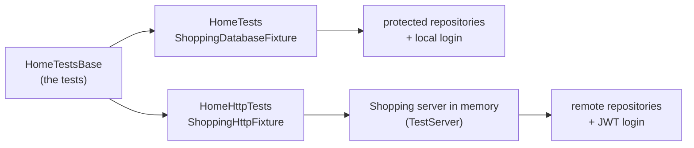

# Testing presenters

A Cube application is plain C# down to the scopes, so a test can do everything a user does without any view: start
the application at an address, call the actions a button would call, read the scopes a view would draw, and check the
address the browser would show. `Wdc.Cube.Testing` adds the few pieces that make this reliable: a history that
records what the application publishes (`TestHistoryManager`), a way to wait until the work in flight is done
(`Settle`), a dispatcher the test pumps by hand (`ManualDispatcher`) and a view that only counts redraws
(`ScopeRenderRecorder`). This guide shows how to use them, from a first test to running one test suite both in
process and through an HTTP server. For why the pieces behave as they do, see [Update cycle](../concepts/update-cycle.md),
[Dispatcher](../concepts/dispatcher.md) and [History](../concepts/history.md).

## 1. The test project

The test project references the presentation and `Wdc.Cube.Testing`, nothing else. This is
`samples/GettingStarted/Contacts.Tests/Contacts.Tests.csproj`:

```xml
<Project Sdk="Microsoft.NET.Sdk">
  <PropertyGroup>
    <OutputType>Exe</OutputType>
  </PropertyGroup>
  <ItemGroup>
    <ProjectReference Include="../Contacts.Presentation/Contacts.Presentation.csproj" />
    <ProjectReference Include="../../../src/Wdc.Cube.Testing/Wdc.Cube.Testing.csproj" />
    <PackageReference Include="xunit.v3" />
  </ItemGroup>
  <ItemGroup>
    <Using Include="Xunit" />
  </ItemGroup>
</Project>
```

The repository runs tests on the Microsoft Testing Platform (set in `global.json`), so a test project is an `Exe`.
Run one project with:

```bash
dotnet test --project samples/GettingStarted/Contacts.Tests/Contacts.Tests.csproj
```

`Wdc.Cube.Testing` brings `Microsoft.Extensions.TimeProvider.Testing` with it, for the tests that control time
(section 8).

## 2. Build and start the application

A test builds the application presenter itself, with a `TestHistoryManager` as its history. The history's
constructor argument is the address the application starts at: empty for a cold start, or a deep link.

```csharp
// samples/GettingStarted/Contacts.Tests/ContactsTests.cs
private static async Task<(ContactsApp App, TestHistoryManager History)> Start(string address = "")
{
    var history = new TestHistoryManager(address);
    var app = new ContactsApp(history, new ContactBook());
    await app.Start();
    await app.Settle();
    return (app, history);
}
```

- No dispatcher is passed, so the application creates its default `SerialDispatcher`. The test awaits the async
  entry points and everything runs in order on that dispatcher.
- `Start()` is the sample's own entry point; it calls `KickStart(safePlace)`. An application without one calls
  `KickStart` directly: `await app.KickStart(Places.Main);`.
- Install a history codec, if the application uses one, before `KickStart`: it reads the address first.

As the tests grow, move this into a small harness class. The one in
`samples/Tutorial/Tutorial.Presentation.Tests/Harness.cs` also owns the clock and two helpers that every test uses:

```csharp
internal sealed class Harness
{
    private Harness(string address, ITutorialService service)
    {
        History = new TestHistoryManager(address);
        Service = service;
        App = new MainPresenter(History, service, timeProvider: Time);
    }

    public FakeTimeProvider Time { get; } = new(new DateTimeOffset(2026, 11, 18, 12, 0, 0, TimeSpan.Zero));

    public TestHistoryManager History { get; }

    public ITutorialService Service { get; }

    public MainPresenter App { get; }

    public MainScope Scope => App.Scope;

    public static async Task<Harness> Start(string address = "", ITutorialService? service = null)
    {
        var harness = new Harness(address, service ?? new TutorialService());
        await harness.App.KickStart(Places.Main);
        await harness.App.Settle();
        return harness;
    }

    public T PresenterOf<T>(Place place)
        where T : class, ICubePresenter => App.PresenterOf<T>(place);

    /// <summary>Runs on the dispatcher (where a view would act) and settles.</summary>
    public async Task On(Action action)
    {
        await App.InvokeAsync(action);
        await App.Settle();
    }

    /// <summary>Calls a scope action (as a view would) and settles.</summary>
    public async Task Do(Func<Task> action)
    {
        await action();
        await App.Settle();
    }
}
```

## 3. Drive the application through its scopes

A test acts the way a view does: it calls the action delegates the presenter bound on the scope. Actions bound with
`Action(...)` already run on the application's dispatcher, so the test can call them from its own thread and await
them.

```csharp
// samples/GettingStarted/Contacts.Tests/ContactsTests.cs
await List(app).OnOpen(2);
await app.Settle();

var detail = Assert.IsType<ContactDetailScope>(List(app).Detail);
Assert.Equal("Alan Turing", detail.Name);
```

Two rules keep these tests honest:

- **Go through the scope, not the presenter.** If a test needs to call a presenter method that no view can reach,
  the behavior is probably missing from the scope.
- **Touch scope properties only on the dispatcher.** Once a presenter owns a scope, setting one of its properties
  from another thread throws `InvalidOperationException`. Wrap such code in `app.InvokeAsync(...)` (the harness's
  `On`). The same applies to attaching a `ScopeRenderRecorder`.

Reading scope properties from the test thread after `Settle()` is fine: nothing else is running at that point.

## 4. Settle before asserting

`await app.Settle()` (an extension method on `CubeApplication`) flushes the pending scope updates and lets the work
queued on the dispatcher run, round after round, until nothing is pending. Assertions then read settled state.

- It throws `InvalidOperationException` when updates do not settle after `maxRounds` (20 by default): a scope
  update loop fails the test instead of hanging it.
- It waits for work **queued on the dispatcher**, not for I/O that is still in flight. When a presenter awaits a real
  database or HTTP call, the continuation is queued only when the answer arrives.
- Never replace it with a fixed sleep.

When presenters do real I/O, wait on what the screen says instead. The Shopping harness
(`samples/Shopping/Shopping.Presentation.Tests/Harness/Shop.cs`) settles until no scope shows a loading state, with a
deadline:

```csharp
public async Task Settle()
{
    var deadline = DateTime.UtcNow.AddSeconds(15);
    do
    {
        await App.Settle();
        await Task.Delay(20, TestContext.Current.CancellationToken);
        await App.Settle();
    }
    while (await App.InvokeAsync(() => Task.FromResult(IsBusy())) && DateTime.UtcNow < deadline);

    Assert.False(IsBusy(), $"Still loading after 15 s. Error toast: {App.Scope.ErrorMessage ?? "(none)"}");
}
```

`IsBusy()` reads the `Loading`, `Buying` and `Saving` flags of the scopes on screen. Waiting on state the user can
see works the same against a fast local database and a slow remote one.

## 5. Read scopes and presenters

What a slot holds is a scope, so `Assert.IsType` both checks which screen is shown and gives the test a typed scope:

```csharp
// samples/GettingStarted/Contacts.Tests/ContactsTests.cs
private static ContactListScope List(ContactsApp app) => Assert.IsType<ContactListScope>(app.Scope.Body);
```

To reach the presenter mounted at a place:

| Call | Returns |
|---|---|
| `app.PresenterOf<T>(place)` (`Wdc.Cube.Testing`) | The presenter, typed. Throws, naming what was found, when there is none or it is another type. |
| `app.GetPresenter<T>(place)` | The presenter, or `null`. Use it to assert that a place is *not* mounted. |
| `app.LastPlace` | The place of the current face (the root before any navigation). |
| `app.PresenterCount` | How many presenters with a place are alive. |
| `presenter.IsReleased` | Whether a presenter has left the face. |

```csharp
// samples/Tutorial/Tutorial.Presentation.Tests/NavigationTests.cs
await h.Do(h.Scope.OnOpenSubscriptions);

Assert.True(todos.IsReleased);
Assert.Null(h.App.GetPresenter(Places.Todos));
Assert.IsType<SubscriptionsScope>(h.Scope.Body);
```

`ScopeActions.IsUnbound(action)` tells whether an action still holds its `ScopeActions.Unbound()` placeholder, so a
test can check that a presenter bound every action of its scope.

## 6. Check the address

`TestHistoryManager` records every address the application publishes, in plain text:

| Member | What it is |
|---|---|
| `Token` | The last address published, or empty. |
| `Tokens` | Every address published, in order. A new entry is recorded only when the state (or its form) changed. |
| `UpdateCount` | How many times the application asked to publish, changed or not. |
| `Location` | The current address, plain. |
| `EncodedToken`, `EncodedTokens`, `WireLocation` | The same, as they travelled, when a codec is installed. |
| `ClearTokens()` | Forgets what was recorded. |

```csharp
// samples/Tutorial/Tutorial.Presentation.Tests/NavigationTests.cs
var h = await Harness.Start();

await h.Do(h.Scope.OnOpenTodos);
await h.Do(h.Scope.OnOpenSubscriptions);
await h.Do(h.Scope.OnHome);

Assert.Equal(["todos", "subscriptions", ""], h.History.Tokens); // the root's address is empty
```

The address is also the input of the other half of the test: start a second application at it and check that the
same screen comes back. That is what a reload (F5) or a shared link does:

```csharp
// samples/GettingStarted/Contacts.Tests/ContactsTests.cs
var (app, _) = await Start("contacts/contact?ct-id=3");

Assert.Equal("Grace Hopper", Assert.IsType<ContactDetailScope>(List(app).Detail).Name);
```

With a codec, `Token` stays readable for assertions and `EncodedToken` is what a reload would see. The Shopping
sample checks both, then reloads from the sealed form with the same session store:

```csharp
// samples/Shopping/Shopping.Presentation.Tests/SealedAddressTestsBase.cs
Assert.Equal($"home/product?pr-id={productId}", shop.History.Token); // the state...
Assert.StartsWith("home/product?_e=", shop.History.EncodedToken, StringComparison.Ordinal); // ...the address
Assert.DoesNotContain("pr-id", shop.History.EncodedToken, StringComparison.Ordinal);

var reloaded = await Shop.Start(db, shop.History.EncodedToken, shop.Session); // F5 on the sealed address
Assert.Equal(productId, reloaded.PresenterOf<ProductPresenter>(Places.Product).Scope.Id);
```

## 7. Back, Forward and links from outside

`TestHistoryManager.Navigate(address)` changes the address the way the user does (Back, Forward, a pasted link) and
tells the application, which flips there as a request from outside. `SetLocation(address)` changes it silently, for
use before the application starts.

```csharp
// tests/Wdc.Cube.Tests/Navigation/ApplicationPresenterTests.cs
app.History.Navigate(""); // the browser back at the address it started from
await app.Settle();

Assert.Same(app.RootPlace, app.LastPlace);
Assert.Equal(0, app.PresenterCount);
```

`TestHistoryManager` keeps no stack: the test says where the user went. To test a real back and forward stack, use
the `MemoryHistoryManager` a desktop host uses; `GoBack()` and `GoForward()` return `false` when there is nowhere to go:

```csharp
// tests/Wdc.Cube.Tests/Navigation/ApplicationPresenterTests.cs
Assert.True(history.GoBack());
await app.Settle();
Assert.Equal("orders?oid=1", history.Location);
Assert.Same(MainPlaces.Orders, app.LastPlace);
Assert.True(history.CanGoForward);
```

## 8. Control time and count redraws

Timers in presenters use the application's `TimeProvider`. Pass a `FakeTimeProvider` (from
`Microsoft.Extensions.TimeProvider.Testing`, which `Wdc.Cube.Testing` references) to the application, as the
harness above does, and move time with `Advance`. The update window (16 ms) runs on the same clock, so `Settle()` is still what flushes.

`ScopeRenderRecorder` is an `IScopeView` that only counts. Attach it to scopes (on the dispatcher) and assert how
many redraws a change caused:

```csharp
// samples/Tutorial/Tutorial.Presentation.Tests/TodoMvcTests.cs
var h = await Harness.Start("todos?tm-uid=-1");
var clock = Todo(h).List!.Clock!;
var recorder = new ScopeRenderRecorder();
await h.On(() => recorder.Attach([clock, .. Rows(h).Take(50)]));
var before = clock.Date;

h.Time.Advance(TimeSpan.FromSeconds(1));
await h.App.Settle();

Assert.True(clock.Date > before);
Assert.Equal(1, recorder.CountFor(clock));
Assert.All(Rows(h).Take(50), r => Assert.Equal(0, recorder.CountFor(r)));
```

With `AutoConfirm = false` the recorder does not call `MarkRendered()`, so a test can hold a scope in
`ScopeRenderState.Rendering` and check what happens to changes made while a view is still drawing.

## 9. Control interleavings

Some behavior depends on order: a response that arrives after the user moved on, an action in the middle of a
navigation. Two tools make the order explicit.

**Gate the service.** Wrap the real service in one whose answers wait for a `TaskCompletionSource` the test
releases. `GatedService` in `samples/Tutorial/Tutorial.Presentation.Tests/Harness.cs` does this per site id; the test
then releases the newer answer first and the older one last:

```csharp
// samples/Tutorial/Tutorial.Presentation.Tests/SubscriptionsTests.cs
h.History.Navigate("subscriptions/detail?sd-site=2"); // the reader moved on before site 1 arrived
// ...
service.SiteGates[2].SetResult(); // the newer answer first...
await WaitUntil(() => Dialog(h).Site == "twitter.com");
service.SiteGates[1].SetResult(); // ...then the older one arrives late
```

**Pump the dispatcher by hand.** Pass a `ManualDispatcher` to the application. Nothing runs until the test calls
`RunOne()`, `RunPending()` or `Run(work)`, all on the test's own thread, in exactly the order the work was queued.
Exceptions nobody awaited are collected in `Unhandled`.

<!-- snippet: manual-dispatcher -->
```csharp
var dispatcher = new ManualDispatcher();
var app = new ContactsApp(new TestHistoryManager(), new ContactBook(), dispatcher);

var start = app.Start();                // queued on the dispatcher: nothing ran yet
Assert.False(start.IsCompleted);
Assert.Null(app.Scope.Body);

dispatcher.Run(() => start);            // runs it on the test's thread, to the end
Assert.IsType<ContactListScope>(app.Scope.Body);
```

Tests on a `ManualDispatcher` are usually synchronous (`void`): the test pumps with `dispatcher.Run(...)` instead of
awaiting, since an `await` would wait for work that only the test itself can run.

## 10. One test suite, locally and through HTTP

An application whose data comes through repository contracts can run its presentation in process (Blazor Server)
or as a client of a server (WebAssembly, desktop). The Shopping sample runs the **same tests** against both, without
changing a line of them.



**The tests live in an abstract base class** that takes the fixture in its constructor:

```csharp
// samples/Shopping/Shopping.Presentation.Tests/HomeTestsBase.cs
public abstract class HomeTestsBase(ShoppingDatabaseFixture db)
{
    [Fact]
    public async Task ProductsPanel_ListsTheCatalogueByName_WithPrices()
    {
        var shop = await Shop.LoggedIn(db, "admin");
        var products = shop.PresenterOf<HomePresenter>(Places.Home).Scope.Products!;
        // ...
    }
}
```

**Each way of connecting is a one-line sealed class** that picks the fixture:

```csharp
// samples/Shopping/Shopping.Presentation.Tests/HomeTests.cs
public sealed class HomeTests(ShoppingDatabaseFixture db) : HomeTestsBase(db), IClassFixture<ShoppingDatabaseFixture>;

// samples/Shopping/Shopping.Presentation.Tests/HomeHttpTests.cs
/// <summary>The same, with the repositories and the login through the Shopping server.</summary>
public sealed class HomeHttpTests(ShoppingHttpFixture db) : HomeTestsBase(db), IClassFixture<ShoppingHttpFixture>;
```

**The fixture decides how the application connects.** `ShoppingDatabaseFixture` creates a throwaway schema and its
virtual `Connect()` returns what the application needs, built the way the Blazor Server host builds it:

```csharp
// samples/Shopping/Shopping.Presentation.Tests/Harness/ShoppingDatabaseFixture.cs
public virtual (ShoppingRepositories Repositories, IAuthentication Authentication) Connect()
{
    var actors = new ActorSource();
    return (ShoppingProtection.Protect(Store!.Repositories, actors),
        new LocalAuthentication(Store.Repositories, actors, id => Domain.Users.HistoryKeys.Derive(HistoryMaster, id)));
}
```

`ShoppingHttpFixture` derives from it, starts the real server in memory over the same schema, and overrides
`Connect()` so that each application instance is a new HTTP client of that server:

```csharp
// samples/Shopping/Shopping.Presentation.Tests/HttpHarness/ShoppingHttpFixture.cs
public override (ShoppingRepositories Repositories, IAuthentication Authentication) Connect()
{
    var client = new Client.ShoppingClient(Server.GetTestClient());
    return (client.Repositories, client.Authentication);
}

protected override async Task OnReady()
{
    var builder = WebApplication.CreateSlimBuilder();
    builder.WebHost.UseTestServer();
    builder.Logging.ClearProviders();
    builder.Services.AddSingleton(TimeProvider.System);
    builder.Services.AddShoppingApi(Store!, new Server.ShoppingAuthOptions());
    _server = builder.Build();
    _server.MapShoppingApi();
    await _server.StartAsync();
}
```

**The harness only asks the fixture.** `Shop` builds the application from `fixture.Connect()` and never knows which
of the two it got:

```csharp
// samples/Shopping/Shopping.Presentation.Tests/Harness/Shop.cs
private Shop(ShoppingDatabaseFixture fixture, string address, ISessionStore session)
{
    History = new TestHistoryManager(address);
    Session = session;
    var (repositories, authentication) = fixture.Connect();
    App = new MainPresenter(History, repositories, session, timeProvider: Time, authentication: authentication);
}
```

To apply the pattern to your own application:

1. Put the tests in an `abstract` `*TestsBase` class whose constructor takes the base fixture.
2. Give the base fixture a `virtual` method that returns the application's dependencies, and override it in a
   fixture that serves them through `Microsoft.AspNetCore.TestHost` (`UseTestServer()`, `GetTestClient()`).
3. Add one `sealed` class per fixture, each with its own `IClassFixture<...>`.
4. Wait on what the screen shows (section 4), not on timings: a call through HTTP is slower than a local one.

The Shopping tests need a database. Without the connection string variable the fixture reads (`WDC_TEST_POSTGRES`,
exported by `source scripts/test-env.sh`), they are skipped with the reason, through `Assert.SkipWhen` in
`Shop.Start`.

## See also

- [Getting started](../getting-started.md), step 8: the first tests of the sample app.
- [Update cycle](../concepts/update-cycle.md): dirty scopes, the flush window and the render handshake.
- [Dispatcher](../concepts/dispatcher.md): the presentation thread and the dispatchers for tests.
- [History](../concepts/history.md): addresses, Back and Forward, sealed addresses.
- [Navigation](../concepts/navigation.md): what a test can expect when a presenter refuses or fails.
- [Remote](../concepts/remote.md): the repositories through HTTP that the `*HttpTests` use.
- [Blazor](blazor.md) and [Avalonia](avalonia.md): testing the views on top of the same presentation.
