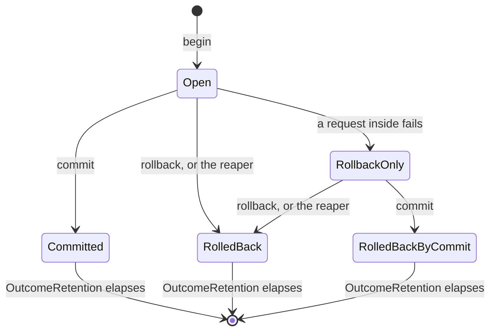

# Wire protocol

This is the reference for everything that crosses the network between a Cube client and a Cube server: the
repository routes, the JSON form of entities, projections and criteria, the errors, remote transactions, and the
sealed address of the history. It is written so that a compatible client or server can be built in another language.
For the reasons behind the design, read [Remote](../concepts/remote.md), [Domain](../concepts/domain.md) and
[History](../concepts/history.md) first.

The rules below describe the C# implementation (`Wdc.Domain`, `Wdc.Rest`, `Wdc.Rest.Server`, `Wdc.Rest.Client`,
`Wdc.Cube.Codec`). Where another implementation of Cube behaves differently, the difference is listed under
[Compatibility notes](#compatibility-notes).

Contents:

1. [Conventions](#conventions)
2. [Values](#values)
3. [Entities](#entities)
4. [Projections](#projections)
5. [Criteria](#criteria)
6. [Repository routes](#repository-routes)
7. [Errors](#errors)
8. [Transactions](#transactions)
9. [Authentication in the Shopping sample](#authentication-in-the-shopping-sample)
10. [Sealed addresses](#sealed-addresses)
11. [Compatibility notes](#compatibility-notes)

The examples use the small domain of the framework's tests:

| Entity | Fields (wire names) |
|---|---|
| `Product` | `id` (key, int64), `name` (string), `price` (decimal), `description` (string), `image` (bytes, not in the default projection), `items` (collection of `PurchaseItem`) |
| `Purchase` | `id` (key, int64), `buyDate` (instant), `user` (reference to `User`), `items` (collection of `PurchaseItem`) |
| `PurchaseItem` | `id` (key, int64), `amount` (int32), `price` (decimal), `purchase` (reference), `product` (reference) |

| Criteria | Fields (wire names) | Orderings |
|---|---|---|
| `ProductCriteria` | `productId` (int64), `name` (text), `price` (decimal) | `NAME_A_TO_Z`, `CHEAPEST_FIRST` |
| `PurchaseItemCriteria` | `amount` (int32), ... | `MOST_EXPENSIVE_FIRST`, ... |

Criteria field names are declared by the criteria class and need not match the entity's field names
(`productId` filters the product's `id`).

## Conventions

- Bodies are JSON, UTF-8. The server answers with `Content-Type: application/json; charset=utf-8`. It does not
  check the request's `Content-Type`; the C# client sends `application/json; charset=utf-8`.
- Every JSON name is case-sensitive.
- Names come from the shared entity model and criteria: both sides must declare the same fields with the same
  names and value kinds.
- **Unknown keys are ignored** everywhere a reader expects an object: in entities, projections, criteria and
  envelopes. A newer peer can add keys without breaking an older one.
- The routes of the repository and of the remote transactions use only `POST` and `GET`.

## Values

Each scalar field has a value kind. The kind fixes how a value is written, what a projection marker looks like, and
how tolerant reading is.

| Kind | Written as | Example | Marker written by the C# side |
|---|---|---|---|
| `int32` | JSON number | `2` | `1` |
| `int64` | JSON number | `7` | `1` |
| `double` | JSON number | `0.5` | `1` |
| `decimal` | JSON number, exact | `10.5` | `1` |
| `string` | JSON string | `"Ball"` | `"~"` |
| `boolean` | `true` / `false` | `true` | `true` |
| `instant` | ISO-8601 string in UTC with `Z`, fraction only when non-zero (up to 7 digits) | `"2026-11-18T12:30:00Z"` | `"1970-01-01T00:00:00Z"` |
| `date` | `yyyy-MM-dd` string | `"2026-11-18"` | `"1970-01-01"` |
| `uuid` | string, hyphenated, lowercase | `"8f14e45f-ceea-4e2b-9c2a-1b4d2f0a6c11"` | `"00000000-0000-0000-0000-000000000000"` |
| `bytes` | standard Base64 string, with padding | `"AQIDBA=="` | `""` |
| enum | the member's name, as declared | `"Admin"` | the name of the first member declared |

Reading:

- `null` is "absent".
- A value of another JSON type is accepted when it converts: a number sent as a string (`"9.9"`), a boolean as
  `"true"`/`"false"` or as a number (`0` is false, anything else true).
- An `instant` is read with an offset (`"2026-11-18T09:00:00-03:00"`), with `Z`, or with neither (taken as UTC).
- `bytes` tolerate line breaks inside the Base64.
- An enum name is matched exactly (case-sensitive); an unknown name reads as absent.
- **A value that does not convert reads as absent** in an entity or a projection, without an error (`"abc"` for a
  decimal, `3000000000` for an int32). Inside a criteria it is refused instead: see
  [Values that do not convert](#values-that-do-not-convert).

## Entities

An entity is a JSON object whose keys are the model's field names.

| Field kind | JSON value |
|---|---|
| Scalar | the value, as in [Values](#values) |
| Reference (N:1, 1:1) | the referenced entity as an object, or `null` |
| Collection (1:N) | an array of child objects, or `null` |

### Writing

- **Without a projection**, only the fields that hold a value are written.
- **With a projection**, exactly the fields it marks are written, and a marked field without a value is written as an
  explicit `null`. That `null` is how "clear this field" travels in an update.
- An entity met a second time in the same graph is written as an object holding only its key. This breaks cycles
  (an item pointing back to its purchase) and repetitions.

```json
{"id":7,"user":{"id":3},"items":[{"id":70,"amount":2,"purchase":{"id":7}}]}
```

### Reading

- A key that is not a field of the model is skipped.
- A reference that is not an object (including `null`) reads as no reference.
- A collection must be an array of objects; other array elements are skipped. A collection value that is neither an
  array nor an object reads as no collection. (An object in a collection's place is a
  [collection envelope](#collections), which only makes sense in a projection.)

### Reading for an update

The `update` route reads the body as an entity **and** records which keys were present, explicit `null`s included.
Presence decides what is written:

| In the body | Meaning |
|---|---|
| key absent | leave the field untouched |
| `"name": "X"` | set it |
| `"name": null` | clear it |
| `"user": {"id": 3}` | point the reference at user 3 (writes the foreign key) |
| `"user": null` | clear the reference |
| `"user": {"id": 3, "name": "X"}` | point at user 3 and also update that user's `name` |
| `"items": [ … ]` | the collection's full state: children with a key are updated, children without one inserted, stored children missing from the list deleted |
| `"items": []` | no children: all stored children are deleted |

For a collection, the fields written for each child are the union of the fields any child carried. Example: in
`{"id":1,"items":[{"id":5,"amount":2},{"price":3}]}` the children are written with `id`, `amount` and `price`, and
`product` is left alone.

## Projections

A projection says which fields to read, or which to write. On the wire it is an entity of the same shape whose
marked fields hold any non-null value. The value is never interpreted, only its presence; the C# side writes the
markers of the [Values](#values) table.

```json
{"id":1,"buyDate":"1970-01-01T00:00:00Z","user":{"id":1,"name":"~"}}
```

- **The value must still read as the field's kind**, since a value that does not convert reads as absent and
  therefore does not mark the field. `"~"` marks a string, but not an instant.
- **References**: `{}` or an object marking only the key asks for the key alone; marking more fields asks for the
  referenced row.
- **The key always comes back**, at every level, whether or not it is marked.
- **No projection** (absent or `null`) means the repository's default: own scalar fields declared in the default
  projection (no blobs or secrets), the key of each reference, no collections.

### Collections

A marked collection is either an array holding one shape:

```json
{"id":1,"items":[{"id":1,"price":1}]}
```

or, to filter, order or slice the children, an envelope:

```json
{"id":1,"items":{"shape":{"id":1,"price":1},
                 "where":{"amount":{"p":[{"o":"GE","v":[2]}]},"orderBy":"MOST_EXPENSIVE_FIRST"},
                 "limit":3,"offset":6}}
```

| Envelope key | Meaning |
|---|---|
| `shape` | The projection of each child. Absent: the child's default projection. |
| `where` | A [criteria](#criteria) of the **child** entity's criteria class, with its own `orderBy`. Read only when the collection declares a criteria; otherwise ignored. |
| `limit`, `offset` | Integers, a slice **per parent**, after the child ordering. A negative or out-of-range value is a 400. |

The envelope is the way criteria reach into child entities: the filter of a collection is always the child's own
criteria, applied within each parent. The C# writer uses the envelope only when there is a filter or a slice, and the
plain array otherwise. In a result, a collection is always a plain array.

## Criteria

A criteria object holds one key per field that filters, plus `orderBy`. A field that asks nothing is not written.

```json
{
  "productId": {"p": [{"o": "EQ", "v": [3]}]},
  "name": {"or": true, "p": [{"o": "LIKE", "v": ["Ball%"]}, {"o": "EQ", "v": ["Tape"]}]},
  "price": {"p": [{"o": "BETWEEN", "v": [10.5, 50.5]}]},
  "orderBy": "CHEAPEST_FIRST"
}
```

### Field object

| Key | Value | Meaning |
|---|---|---|
| `p` | array of requests | The requests on this field. Elements that are not objects are skipped. An empty array asks nothing. |
| `or` | `true` | The field's requests combine with OR. Absent, or any other value: AND. |

Each request:

| Key | Value | Meaning |
|---|---|---|
| `o` | operator name (string) | See the table below. A request without a known `o` is dropped. |
| `v` | array of values in the field's kind | The operands. Omitted when the operator takes none. `null` elements are kept as null operands. |

Combination:

- Requests on one field combine with AND, or with OR when `or` is `true`.
- Different fields always combine with AND.
- The server may add restrictions of its own (the caller's reach, see
  [Protected repositories](../concepts/protected-repositories.md)). They never travel, and they always combine with
  AND outside the client's requests: `"or": true` on a restricted field widens only the client's own requests.

### Loose values

A field may also be a bare value, read as equality: `"productId": 3` is `{"p":[{"o":"EQ","v":[3]}]}`. A bare `null`
asks nothing; a bare value that does not convert (`"abc"` for a decimal, an array) is refused with 400. The C# writer
always writes the field object.

### Operators

| `o` | Operands | Meaning in SQL | `null` operand |
|---|---|---|---|
| `EQ` | exactly 1 | `= v` | `EQ [null]` means `IS NULL` |
| `NE` | exactly 1 | `<> v` | `NE [null]` means `IS NOT NULL` |
| `GT`, `GE`, `LT`, `LE` | exactly 1 | `>`, `>=`, `<`, `<=` | refused (400) |
| `BETWEEN` | exactly 2 | inclusive on both ends | refused (400) |
| `LIKE` | exactly 1 (text) | `LIKE v`, with `%` and `_` as wildcards and `\` as the escape character | refused (400) |
| `ILIKE` | exactly 1 (text) | case-insensitive `LIKE`, as the database does it | refused (400) |
| `IN` | any number, zero included | `IN (…)` | null operands add `OR IS NULL`; `IN []` matches nothing |
| `IS_NULL` | none | `IS NULL` | — |
| `IS_NOT_NULL` | none | `IS NOT NULL` | — |

Validation, on reading:

- **A request with the wrong number of operands is refused** with 400 (`BETWEEN` with one, `LE` with none,
  `IS_NULL` with one). So is a `null` operand where only a value compares (`GT`, `GE`, `LT`, `LE`, `BETWEEN`,
  `LIKE`, `ILIKE`). Kept, such a request would count as a filter yet translate to none, and a `delete` would reach
  every row.
- **`LIKE` and `ILIKE` on a field that is not text are refused** with 400, for the same reason.
- **An unknown operator is dropped**: the filter gets looser, never different. If that leaves the field empty, the
  field does not filter.
- The server translating to SQL refuses, as a last guard, any request it cannot render, instead of leaving it out.

`IN []` is a real request: a search finds nothing and a `delete` removes nothing. The way to say "no filter on this
field" is to leave the field out.

### Values that do not convert

An operand that does not read as the field's kind is refused with 400, under every operator:
`{"price":{"p":[{"o":"EQ","v":["abc"]}]}}` is not read as `price IS NULL`. Only an explicit JSON `null` is a `null`
operand. A value of another JSON type that converts (`"9.9"` for a decimal) is accepted, as everywhere.

### orderBy

- A string naming one of the criteria's orderings, in upper snake case (`CheapestFirst` travels as `CHEAPEST_FIRST`).
  The ordering is named by its effect, not by columns; the server adds the key as a tie-breaker.
- `null` or absent: the repository's default order.
- **An unknown name is refused** with 400, and the message lists the accepted names. Unlike an unknown operator, it
  is not dropped: the list would come back in some order presented as the one asked for.
- A criteria class without orderings refuses any non-null `orderBy`.

### anyOf

Alternative groups are server-side only and never travel. A criteria with an `anyOf` key, whatever its value, is
refused with 400, at any depth: the query body, a collection's `where`. Skipping it would answer with a looser filter
than the one asked for. A client refuses to write a criteria that has groups.

## Repository routes

### Base path

Each repository is served under a base path chosen by the server. The convention is `/api/repo/<entity>`, in
lowercase with hyphens (`/api/repo/product`, `/api/repo/purchase-item`). The routes are relative to it:

| Method and route | Request body | Answer (200) | Notes |
|---|---|---|---|
| `POST {base}/count` | query | `{"count":N}` | |
| `POST {base}/fetch` | query, `offset`/`limit` | `{"items":[…]}` | at most `MaxItems` items |
| `POST {base}/fetch-page` | query, `page`/`pageSize` | `{"items":[…],"totalItems":N}` | `pageSize` from 1 to `MaxItems` |
| `POST {base}/fetch-by-id` | `{"id":…,"projection":{…}}` | the entity | 404 when not found or out of reach |
| `GET {base}/{id}` | — | the entity, default projection | 404 when not found or out of reach |
| `POST {base}/insert` | `{"entity":{…},"projection":{…}}` or the entity alone | `{"success":true,"id":…,"entity":{…}}` | write |
| `POST {base}/update` | the entity's key and the fields to write | `{"success":true}` | write; 400 without the key |
| `POST {base}/delete` | query | `{"count":N}` | write; 400 without a filter |

A server may serve a repository read-only; the three write routes then do not exist (404).

### Query body

`count`, `fetch`, `fetch-page` and `delete` take one object that mixes the criteria's fields with these reserved
keys:

| Key | Value | Used by |
|---|---|---|
| `orderBy` | ordering name or `null` | all |
| `projection` | a [projection](#projections), or `null` | `fetch`, `fetch-page` (ignored by `count` and `delete`) |
| `offset` | integer ≥ 0; `0` = no skip | `fetch` |
| `limit` | integer ≥ 0; `0` = no limit | `fetch` |
| `page` | integer ≥ 0, zero-based | `fetch-page` |
| `pageSize` | integer from 1 to `MaxItems` | `fetch-page` |

- The four slice keys must be JSON integers; a string, a fraction or a negative number is a 400.
- A slice key not used by the operation is ignored.
- A key that is neither reserved nor a criteria field is ignored. A criteria field cannot be named like a reserved key.
- The body must be a JSON object; an empty body is a 400. An empty object `{}` is a valid query that filters nothing.
- The C# client writes the criteria fields, then `orderBy`, `projection`, and only the slice keys greater than zero.

```
POST /api/repo/product/fetch
{"productId":12,"projection":{"id":1,"name":"~"}}

200 {"items":[{"id":12,"name":"Ball"}]}
```

```
POST /api/repo/product/fetch-page
{"name":{"p":[{"o":"ILIKE","v":["%ball%"]}]},"orderBy":"CHEAPEST_FIRST","page":0,"pageSize":20}

200 {"items":[{"id":12,"name":"Ball","price":10.5,"description":null}],"totalItems":1}
```

### Results

- Each item carries the fields the projection marks, with explicit `null` where the value is absent, and the key at
  every level. A reference is an object or `null`; a collection is an array.
- `totalItems` is the number of rows that match, regardless of the page.
- `fetch` with `limit` greater than `MaxItems` is a 400. `fetch` with no `limit` that matches more than `MaxItems`
  rows is a 400 too ("page the request"): the answer is never silently cut.
- Without a `projection`, the repository chooses: its default projection, or, behind a data policy, the default shape
  trimmed to what the actor may read. The answer is written with the default projection's keys.

### fetch-by-id

```
POST /api/repo/product/fetch-by-id
{"id":12,"projection":{"id":1,"name":"~","price":1}}

200 {"id":12,"name":"Ball","price":10.5}
```

- `id` is required, as a JSON number or string in the key's kind; anything else, or a value that does not read as a
  key, is a 400.
- Not found, or outside the caller's reach: 404 `{"error":"Not found"}`. The two are indistinguishable on purpose.

`GET {base}/{id}` does the same with the key in the path (`GET /api/repo/product/12`) and the default projection.

### insert

The envelope carries the entity and, optionally, the projection that says which fields to write:

```
POST /api/repo/product/insert
{"entity":{"id":null,"name":"Keyboard","price":80.5},"projection":{"id":1,"name":"~","price":1}}

200 {"success":true,"id":31,"entity":{"id":31,"name":"Keyboard","price":80.5,"description":null}}
```

- **Envelope or bare entity.** A body with a top-level key `entity` is the envelope; any other body is the entity
  itself, inserted without a projection. An entity that has a field named `entity` must use the envelope.
- Without a projection, the fields holding a value are written, and every collection holding a non-empty list is
  inserted with the parent; references are written as their foreign key only. With a projection, exactly what it
  marks (see [Domain](../concepts/domain.md)).
- The answer's `id` is the stored key in its kind, `-1` when there is none. `entity` is the row as stored, with all
  of its own fields (explicit `null`s included): the key, column defaults and anything the server filled in. The
  client copies back what it did not write.
- `{"success":false}` (no `id`, no `entity`) when the repository reports nothing was inserted.

### update

```
POST /api/repo/product/update
{"id":31,"name":"Keyboard 2","description":null}

200 {"success":true}
```

- The body is the entity read [for an update](#reading-for-an-update): the key plus exactly the fields to write.
- Without the key: 400. Outside the caller's reach: 404.
- `{"success":false}` when the repository reports nothing was written.
- The C# client sends the same choice of fields a local update would write, and makes no call when there is nothing
  to write.

### delete

```
POST /api/repo/product/delete
{"productId":31}

200 {"count":1}
```

- A query whose criteria asks nothing (`{}`, or only unknown keys and dropped operators) is refused with 400. The
  caller's reach alone is not a filter: "delete all mine" is refused too.
- `count` is the number of rows deleted, children deleted in cascade not included.

### Limits

| Option (`RestServerOptions`) | Default | Effect |
|---|---|---|
| `MaxBodyBytes` | 16 MiB | A larger request body is a 400, checked on `Content-Length` and while reading. |
| `MaxItems` | 1,000 | Largest `limit` and `pageSize`, and largest result of `fetch` without `limit`. |
| `RefuseWritesOutsideOpenTransaction` | `true` | See [Transactions per request](#transactions-per-request). |
| `OwnerOf` | `user:<id>\|client:<X-Client-Id>` | Who owns a remote transaction. See [Owner](#owner). |

`count` and `delete` have no limit of their own.

## Errors

Every error answer has the same body:

```json
{"error":"unknown ordering: 'BY_MOOD' — accepted: NAME_A_TO_Z, CHEAPEST_FIRST"}
```

| Status | Server side | Client side (C#) |
|---|---|---|
| 400 | `InvalidRequestException`; also malformed JSON (`JsonException`) and `FormatException` | `InvalidRequestException` |
| 401 | `AuthenticationException` | `AuthenticationException` |
| 403 | `AccessDeniedException` | `AccessDeniedException` |
| 404 | `KeyNotFoundException`, or a handler that found nothing | `KeyNotFoundException` (`fetch-by-id`: `null`) |
| 409 | `TransactionConflictException` | `TransactionConflictException` (on a `commit`: `TransactionSystemException`) |
| 410 | `TransactionNotFoundException` | `TransactionNotFoundException` |
| 429 | `TooManyRequestsException` (remote transaction limit, rate limiter), with `Retry-After` in seconds when known | `TooManyRequestsException` with `RetryAfter` (on `begin`: `TransactionLimitExceededException`) |
| 500 | anything else, with the fixed message `Internal server error` (the detail is logged, never sent) | `RemoteCallException` |
| other | not produced by the routes (a proxy, the host) | `RemoteCallException` |

- The message is meant for people and logs. Do not parse it.
- A client that cannot read an `error` member (an empty body, an HTML page) uses `HTTP <status>` as the message.
- A route that does not exist answers the host's 404, possibly without a body.
- Every answer of the routes, errors included, carries `X-Content-Type-Options: nosniff`, `X-Frame-Options: DENY` and,
  unless the route set its own, `Cache-Control: no-store` (the server can change them). `Server-Timing` is sent only
  when the server turns it on.

## Transactions

### Headers

| Header | Sent by | Meaning |
|---|---|---|
| `X-Tx-Id` | client | The remote transaction this request belongs to. |
| `X-Client-Id` | client | One client instance (one app on one device). Part of the transaction's owner. The C# client sends it on every request; by default it is a new GUID per client instance. |

### Transactions per request

The server picks the transaction of each repository request in this order:

1. **With `X-Tx-Id`**: the request runs inside that remote transaction, reads included, so they see the
   transaction's own writes. If the server has no remote transactions, 400.
2. **A write without `X-Tx-Id`** while the same owner has a remote transaction open: 409. It is almost always a lost
   header, and the write would bypass the transaction. Another owner (the same user on another device) is not
   affected. This check is skipped when the request has no owner or when `RefuseWritesOutsideOpenTransaction` is off.
3. **Any other write** (`insert`, `update`, `delete`) runs in a transaction of its own, committed before the answer
   is sent.
4. **Any other read** runs without a transaction.

### Remote transaction routes

Base path `/api/tx` (configurable on both sides).

| Method and route | Headers | Body | Answer (200) |
|---|---|---|---|
| `POST /api/tx/begin` | `X-Client-Id`, credentials | ignored | `{"txId":"…"}` |
| `POST /api/tx/commit` | `X-Tx-Id`, `X-Client-Id`, credentials | ignored | `{"status":"committed"}` (a doomed transaction: 409) |
| `POST /api/tx/rollback` | `X-Tx-Id`, `X-Client-Id`, credentials | ignored | `{"status":"rolledback"}` |
| `GET /api/tx/status` | `X-Tx-Id`, `X-Client-Id`, credentials | — | `{"status":"open"\|"committed"\|"rolledback"\|"unknown"}` |

- `txId` is an opaque string (currently 32 lowercase hexadecimal characters). Treat it as opaque.
- `commit`, `rollback` and `status` without `X-Tx-Id`: 400.
- `begin` beyond the limits: 429.

### Owner

Each transaction belongs to the owner computed when it began. By default the owner combines the authenticated user
(the `NameIdentifier` claim, else `sub`) and `X-Client-Id`; either may be missing.

- Every request in the transaction, and its `commit`, `rollback` and `status`, must present the same user and the
  same `X-Client-Id`. Otherwise: 403.
- A transaction begun with neither a user nor an `X-Client-Id` has no owner: anyone who knows its id can use it, and
  it is counted against `MaxOpen` only.

### Lifecycle



- **One request at a time.** A request or a `commit` that arrives while another request runs in the same
  transaction is refused with 409 ("in use"); the request in progress is not disturbed. A `rollback` that arrives
  then takes effect at once (later requests get 410, `status` says `rolledback`), and the connection is rolled back
  when the request in progress ends.
- **A failed request dooms the transaction.** Any error raised while a request runs inside the transaction (a 400
  for a malformed body or a `fetch` over `MaxItems`, a 403 from a policy, a database error) marks it rollback-only,
  even if the client catches the error and goes on. A 404 from `fetch-by-id` is not an error and does not.
  Refusals before the request joins the transaction (403 for another owner, 409 in use, 410 for an unknown id, a
  body over `MaxBodyBytes`) do not either.
- **A doomed transaction still accepts requests**, but its commit rolls back and is refused with 409, so no client
  can take it for a success.
- **A commit that fails in the database** answers the error of that failure (usually 500), and the outcome is
  remembered as rolled back.
- **Expiry.** A transaction idle for `IdleTimeout`, or older than `MaxLifetime`, is rolled back by a background
  reaper, checked every `ReapInterval`. One serving a request at that moment is looked at again on the next round.
- **Outcomes are remembered** for `OutcomeRetention` after the transaction ends, then forgotten (`unknown`).

The answers by state:

| State | `commit` | `rollback` | `status` | request with `X-Tx-Id` |
|---|---|---|---|---|
| open | 200 `committed` | 200 `rolledback` | `open` | runs |
| open, a request running | 409 (in use) | 200 `rolledback` (the connection rolls back when the request ends) | `open` | 409 (in use) |
| open, doomed (a request failed) | 409 (rolled back) | 200 `rolledback` | `open` | runs |
| committed | 200 `committed` (repeat) | 409 | `committed` | 410 |
| rolled back by `rollback` or by the reaper | 409 | 200 `rolledback` (repeat) | `rolledback` | 410 |
| rolled back by a `commit` (doomed, or a failed commit) | 409 (repeat) | 200 `rolledback` | `rolledback` | 410 |
| unknown, or forgotten | 410 | 410 | `unknown` | 410 |
| any, another owner | 403 | 403 | 403 | 403 |

Repeating an outcome answers the same, so a client may resend a commit or rollback whose answer it lost. Asking for
the opposite outcome is a 409; a transaction that no longer exists is a 410; neither is ever a server error.

### Limits (`RemoteTransactionOptions`)

| Option | Default | Effect |
|---|---|---|
| `MaxOpen` | 128 | Open at once in total; each holds a database connection. `begin` beyond it: 429. |
| `MaxOpenPerOwner` | 16 | Open at once per user, all its clients together (per client when anonymous). `begin` beyond it: 429. |
| `IdleTimeout` | 60 s | Rolled back after this long without a request. |
| `MaxLifetime` | 10 min | Rolled back after this long, used or not. |
| `OutcomeRetention` | 5 min | How long `status` and repeated `commit`/`rollback` remember the outcome. |
| `ReapInterval` | 5 s | How often the reaper looks. |

### What a client does

The C# `RemoteTransactionService` follows this procedure; another client should do the same:

1. `POST /api/tx/begin`; send the `txId` as `X-Tx-Id` on every request of the unit of work.
2. If the work fails, or a nested participant failed (even if its caller caught the error), send `rollback` and
   report the failure. If the work asked for rollback only, send `rollback` and report success.
3. Otherwise send `commit`: `committed` is success; a 409 means a request inside failed and the server rolled back,
   and is a failure; a 410 means the transaction expired, and is a failure too.
4. **If the answer to the commit is lost** (connection reset, timeout), do not guess: `GET /api/tx/status`.

| `status` after a lost commit answer | Outcome |
|---|---|
| `committed` | success |
| `rolledback` | failure |
| `open` | the commit never arrived: send `rollback`, report failure |
| `unknown`, or no answer | the outcome is unknown: report that, distinctly |

After-commit tasks run on the client after a successful commit; their failures do not undo it.

## Authentication in the Shopping sample

The framework does not define authentication: the repository routes only need the server to know who the request
acts for, and the default owner of a remote transaction reads the user from the authenticated principal. What
follows is **the convention of the Shopping sample** (`samples/Shopping`), shown as a working example.

- **Bearer tokens.** Every route under `/api` requires `Authorization: Bearer <access token>`, except `/api/auth/*`
  and `GET /api/repo/product/{id}/image`. Without a valid token: 401 `{"error":"Authentication required."}`.
- **Access token**: a JWT signed with HMAC-SHA256. `iss` and `aud` are the configured issuer (`wdc-shopping` by
  default). Claims: `sub` (the user id), `name`, one `role` claim per role, `iat`, `nbf`, `exp`. It lives 15 minutes;
  30 seconds of clock skew are tolerated.
- **Refresh token**: 32 random bytes in Base64, kept in the server's memory, valid for 8 hours and **single-use**:
  each refresh spends it and returns a new pair.

| Route | Request | Answer |
|---|---|---|
| `GET /api/auth/challenge?userName=<name>` | — | `{"nonce":"…","salt":"<base64>","iterations":100000}` |
| `POST /api/auth/login` | `{"userName":"…","nonce":"…","digest":"<base64>"}` | the session (below), or 401 |
| `POST /api/auth/refresh` | `{"refreshToken":"…"}` | a new session, or 401 |
| `POST /api/auth/logout` | `{"refreshToken":"…"}` | `{"success":true}`, always |

The session:

```json
{"userId":7,"name":"Ana","accessToken":"eyJ…","refreshToken":"…","expiresAt":"2026-11-22T12:15:00+00:00",
 "historyKey":"<43 base64url characters>","roles":"customer"}
```

- `expiresAt` is when the access token expires, in ISO-8601 with an offset. `roles` is a comma-separated list, or
  `null`. `historyKey` is the user's [sealed address](#sealed-addresses) key.
- **Challenge login.** The password never leaves the client. The challenge returns a single-use nonce (valid for 2
  minutes), the user's salt and the iteration count. The client computes
  `derived = PBKDF2-HMAC-SHA256(password, salt, iterations, 32 bytes)` and
  `digest = Base64(HMAC-SHA256(key = derived, message = UTF-8(userName + nonce)))`.
- For an unknown user the challenge answers a fake salt that is stable per name, so it does not reveal who exists.
- A missing or empty field in these bodies is a 400.
- When a call answers 401, the C# client calls its refresh hook once and repeats the call; if the refresh fails the
  call fails with `AuthenticationException`.

## Sealed addresses

The history can seal the query part of an address so that its parameters are neither readable nor alterable
(see [History](../concepts/history.md#sealed-addresses)). `AesHistoryCodec` writes:

```
<path>?_e=<payload>
payload  = base64url-without-padding( envelope )
envelope = version (1 byte) ‖ flags (1 byte) ‖ V (16 bytes) ‖ C
```

| Part | Content |
|---|---|
| parameter | `_e` by default (configurable). An envelope is the whole query: exactly one parameter, and the query holds no `&`. A query that is not an envelope is read as plain. |
| `version` | The key version, 1 to 255. Selects the key that opens the payload. |
| `flags` | Bit 0: the plaintext was compressed with raw DEFLATE (RFC 1951, no zlib header). Other bits are 0. |
| `V ‖ C` | AES-SIV (RFC 5297) output: the 16-byte synthetic IV, then the ciphertext, as long as the plaintext. |
| plaintext | The UTF-8 query string (`state=todo&page=2`), deflated when bit 0 is set. |

- **Key**: 32 bytes, that is AES-SIV with AES-128: the first 16 bytes key S2V (CMAC), the last 16 key CTR. As text, a
  key travels as 43 base64url characters.
- **Associated data**: one empty component (the empty nonce of the reference implementation). There is no separate
  nonce field: AES-SIV is deterministic, so the same query under the same key gives the same address.
- **Compression** is applied only when the deflated bytes are shorter than the plaintext, which in practice means
  long queries (roughly 200 characters and up).
- **Opening** fails cleanly (the address opens with no parameters) when the payload is not base64url, is shorter
  than 2 bytes, names a version not offered, does not authenticate, or does not inflate.
- **Rotation**: new addresses use the current version; older versions offered for reading still open.
- The payload contains only URL-safe characters, so it needs no escaping.

The format is the TypeScript implementation's. The test suite checks it against addresses produced by that
implementation, for example, with key bytes `00 01 … 1f` as version 1:

| Query | Payload |
|---|---|
| `a=1` | `AQC6tNk4icimzkzIDoNh8Pz54g6N` |
| `state=todo&page=2` | `AQCjRtWZy5B98I2Jf1ZQoC5sD9yjrxh6nGFgxivEc0WrIyA` |
| (empty) | `AQBkahw-_rfSWJv90IksyGkj` |

For these uncompressed vectors both implementations produce the same payload, byte for byte. A compressed payload
produced by the TypeScript implementation opens here (also tested). The reverse direction, and byte equality of
compressed payloads, are not covered by a cross-implementation test: the two use different DEFLATE encoders.

## Compatibility notes

The repository wire, the criteria format and the projection envelope are shared with the Kotlin implementation of
Cube; the sealed address is shared with the TypeScript implementation. The status codes, limits and error cases in
this document hold for both servers. One difference remains in the code:

| Topic | C# | Kotlin |
|---|---|---|
| Fields marked by the projection but empty, in results | written as `null` | the entity is written as read, so an empty field may be omitted |

It is harmless in mixed deployments: readers treat an omitted field and an explicit `null` alike in results.

## See also

- [Remote](../concepts/remote.md): server, client and how the presentation stays unaware of the transport.
- [Domain](../concepts/domain.md): entity models, projections, criteria.
- [Transactions](../concepts/transactions.md) and [Protected repositories](../concepts/protected-repositories.md).
- [History](../concepts/history.md): addresses and sealed addresses.
- [Describe the API](../guides/rest.md#9-describe-the-api-openapi): the same contract as an OpenAPI document, built
  from the server's models.
